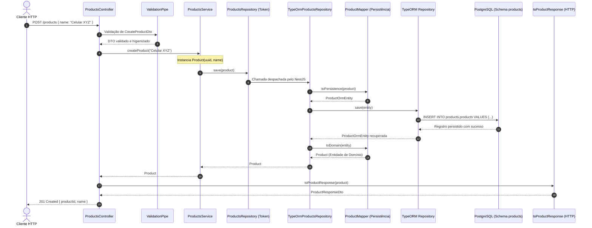
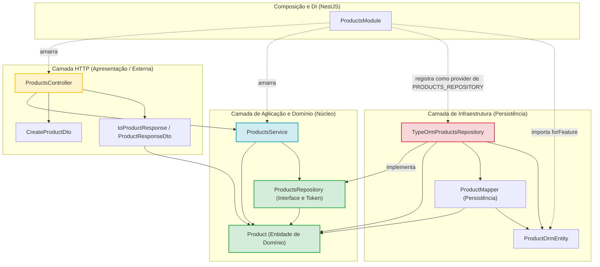

# ARTEFATO 12-02 — RECONSTRUÇÃO DA ARQUITETURA E MAPA DE DEPENDÊNCIAS

## 1. Distinção Obrigatória: Fluxo de Execução × Dependências Arquiteturais

Uma falha conceitual comum em revisões arquiteturais é confundir a direção das chamadas em tempo de execução (*runtime*) com a direção das dependências de código em tempo de compilação (*design-time / compile-time*). Na arquitetura do CeliLac (UC12), a Inversão de Dependências (DIP) garante que a aplicação não dependa dos detalhes de infraestrutura.

---

## 2. Fluxo de Execução em Tempo de Execução (Runtime)

O fluxo de execução descreve a sequência temporal em que as mensagens e dados transitam pelos componentes durante o processamento de uma requisição `POST /products`:



### Representação Textual Linear do Fluxo:
```text
Cliente HTTP
  └── (1) Requisição POST /products
      └── (2) ProductsController
          └── (3) ValidationPipe (higienização e validação de CreateProductDto)
              └── (4) ProductsService.createProduct(name)
                  ├── instancia Product(randomUUID(), name)
                  └── (5) ProductsRepository.save(product)
                      └── (6) TypeOrmProductsRepository.save(product)
                          ├── (7) ProductMapper.toPersistence(product)
                          ├── (8) TypeORM Repository<ProductOrmEntity>.save(entity)
                          │       └── (9) SQL INSERT no PostgreSQL (banco celilac_db)
                          └── (10) ProductMapper.toDomain(savedEntity)
                              └── (11) Retorno de Product ao ProductsService
                                  └── (12) Retorno de Product ao ProductsController
                                      └── (13) toProductResponse(product)
                                          └── (14) Resposta HTTP 201 com ProductResponseDto
```

---

## 3. Mapa de Dependências Arquiteturais (Tempo de Compilação)

Diferente do fluxo temporal, as dependências de código (expressas nas cláusulas `import` do TypeScript) convergem para o **núcleo do domínio e da aplicação**. A camada de infraestrutura depende da aplicação, e não o contrário:



---

## 4. Auditoria dos Dois Mappers Distintos

O projeto possui dois mappers claramente segregados que atendem a fronteiras distintas:

| Característica | Mapper HTTP (`toProductResponse`) | Mapper de Persistência (`ProductMapper`) |
|---|---|---|
| **Localização** | `src/modules/products/mappers/product-response.mapper.ts` | `src/infrastructure/persistence/products/product.mapper.ts` |
| **Fronteira** | Domínio → Apresentação Externa (HTTP) | Domínio ↔ Infraestrutura (TypeORM / Relacional) |
| **Sentido** | Unidirecional (`Product → ProductResponseDto`) | Bidirecional (`toPersistence` e `toDomain`) |
| **Tipo de Retorno** | Objeto literal TypeScript / DTO público | Instância de `ProductOrmEntity` ou `Product` |
| **Regras de Negócio** | Nenhuma (apenas projeção de campos permitidos) | Nenhuma (apenas adaptação de formato relacional) |
| **Motivo da Separação** | Proteger consumidores HTTP contra vazamento de atributos internos e permitir evolução do domínio sem quebra de API pública. | Desacoplar o modelo de domínio corporativo das especificidades de banco e decorators do TypeORM. |

---

## 5. Composição de Dependências e Resolução de Providers no NestJS

Como as interfaces do TypeScript são apagadas durante a transpilação para JavaScript (*type erasure*), uma interface pura não pode ser utilizada como token de injeção em tempo de execução. O NestJS resolve isso por meio da composição explícita no módulo:

### Injeção no Serviço (`ProductsService`):
```typescript
@Injectable()
export class ProductsService {
  constructor(
    @Inject(PRODUCTS_REPOSITORY)
    private readonly productsRepository: ProductsRepository,
  ) {}
  ...
}
```

### Configuração no Módulo (`ProductsModule`):
```typescript
@Module({
  imports: [TypeOrmModule.forFeature([ProductOrmEntity])],
  controllers: [ProductsController],
  providers: [
    ProductsService,
    {
      provide: PRODUCTS_REPOSITORY,
      useClass: TypeOrmProductsRepository,
    },
  ],
  exports: [ProductsService],
})
export class ProductsModule {}
```

### Justificativa Arquitetural da Composição:
* O `ProductsModule` atua como o **Composer Root** da funcionalidade.
* O `ProductsService` permanece agnóstico quanto à implementação concreta: em testes integrados (`products.integration.spec.ts`), o token `PRODUCTS_REPOSITORY` é facilmente substituído por `InMemoryProductsRepository` através de `overrideProvider`.
* Em produção e no contêiner da aplicação, o NestJS injeta a classe `TypeOrmProductsRepository`, que recebe internamente o `Repository<ProductOrmEntity>` injetado pelo TypeORM via `@InjectRepository`.

---

## 6. Evidências Concretas de Isolamento nos Arquivos Inspecionados

1. **`product.entity.ts`:**
   - Contém apenas propriedades puras: `productId: string`, `name: string`.
   - **Zero** imports de TypeORM, NestJS, Express ou qualquer biblioteca externa.
2. **`products.repository.interface.ts`:**
   - Declara o token constante `PRODUCTS_REPOSITORY = 'PRODUCTS_REPOSITORY'`.
   - Declara o método `save(product: Product): Promise<Product>`.
   - **Zero** menções a `ProductOrmEntity`, `FindOptions` ou `Repository` do TypeORM.
3. **`products.service.ts`:**
   - Importa apenas `@Inject`, `@Injectable` (NestJS utilitário neutro), `randomUUID` (`node:crypto`), `Product` e a interface/token `ProductsRepository`.
   - **Zero** imports de `src/infrastructure` ou `typeorm`.
4. **`products.controller.ts`:**
   - Injeta apenas `ProductsService`.
   - Importa apenas `CreateProductDto`, `toProductResponse`, `ProductResponseDto` e decorators HTTP (`@Controller`, `@Post`, `@Body`).
   - **Zero** imports de `typeorm` ou persistência.
5. **Verificação Objetiva de Imports Indevidos (Grep):**
   - `grep -n "typeorm" src/modules/products/entities/product.entity.ts src/modules/products/repositories/products.repository.interface.ts src/modules/products/services/products.service.ts src/modules/products/controllers/products.controller.ts` → **0 ocorrências (código 1)**.
   - `grep -n "infrastructure" src/modules/products/services/products.service.ts src/modules/products/controllers/products.controller.ts` → **0 ocorrências (código 1)**.
