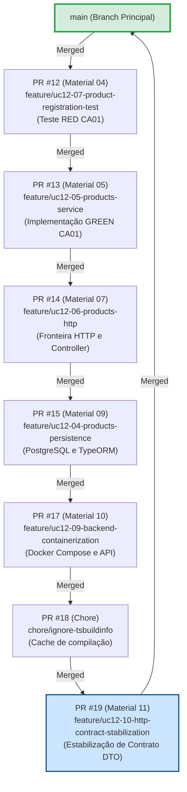

# Roteiro Prático de Governança e Conclusão Formal do Caso de Uso (UC12)

**Projeto CeliLac** · `UC12 — Cadastrar Produto` · Repositório [`evertonfoz/dsc-tests`](https://github.com/evertonfoz/dsc-tests)  
Pós-Material 12 (Auditoria Arquitetural, Revisão Técnica, Integração de Pull Requests e Governança no GitHub)

---

## 0. Identificação Real do Projeto e Parâmetros Verificados

Todos os identificadores a seguir foram verificados diretamente no repositório local e no GitHub:

| Elemento / Parâmetro | Valor Real no Projeto CeliLac |
|---|---|
| **Repositório** | [`evertonfoz/dsc-tests`](https://github.com/evertonfoz/dsc-tests) |
| **Caso de Uso** | `UC12 — Cadastrar Produto` (`prompts/uc-12.md`) |
| **Issue Principal (Epic)** | [Issue #1 — `EPIC-UC12 — [UC12] Cadastrar Produto`](https://github.com/evertonfoz/dsc-tests/issues/1) |
| **Sub-Issues Mapeadas** | Issues `#4` a `#11` e `#16` |
| **Pilha de Pull Requests (Base ao Topo)** | PRs `#12`, `#13`, `#14`, `#15`, `#17`, `#19` (além do `#18` de manutenção) |
| **Branch Principal** | `main` |
| **Último PR da Pilha** | [PR #19](https://github.com/evertonfoz/dsc-tests/pull/19) (`feature/uc12-10-http-contract-stabilization`) |
| **GitHub Project** | [Project #6 — `CeliLac — UC12 Cadastrar Produto`](https://github.com/users/evertonfoz/projects/6) |
| **Diretório dos Artefatos do M12** | `docs/planejamento/uc12-cadastrar-produto/12/` |
| **Decisão da Auditoria (M12)** | **Cenário B — Preservação Arquitetural Justificada** (Diff de produtos vazio) |

---

## 1. Visão Geral: O Caso de Uso Já Está Concluído?

A resposta estrutura-se em **duas dimensões complementares**: a técnica/didática e a de governança no GitHub.

### 1.1. Dimensão Técnica e Didática (Materiais 01 a 12)
**Situação: 100% CONCLUÍDA E COMPROVADA.**  
Todo o código, infraestrutura, persistência, contratos e testes automatizados estão implementados e validados por evidências no repositório:

| Critério / Entrega | Status | Evidência Concreta no Repositório |
| :--- | :---: | :--- |
| **CA01: Cadastro com dados válidos** | **Concluído** | `ProductsService.createProduct` implementado; testado em `src/modules/products/services/products.service.spec.ts` (1 teste) e `products.integration.spec.ts`. |
| **CA02: Rejeição de nome obrigatório ausente/vazio** | **Concluído** | `ValidationPipe` e `CreateProductDto` com `@IsNotEmpty()`; testado em `products.controller.spec.ts` com `400 Bad Request`. |
| **CA03: Não persistência de dados rejeitados** | **Concluído** | `products.integration.spec.ts` comprova `expect(saveSpy).not.toHaveBeenCalled()` para entradas inválidas. |
| **CA04: Cobertura por testes automatizados** | **Concluído** | 6 testes rápidos aprovados em `src/modules/products/` (554ms) e 1 teste de integração real PostgreSQL aprovado em `typeorm-products.repository.postgres.spec.ts` (453ms). |
| **CA05: Resposta compatível com o resultado (201 / 400)** | **Concluído** | `POST /products` retorna `201 Created` com `ProductResponseDto` (`{ productId, name }`); campos internos filtrados via `toProductResponse`. |
| **Persistência Real PostgreSQL 17** | **Concluído** | Adaptador `TypeOrmProductsRepository`, migration `1794255600000-CreateProductsTable.ts`, dados confirmados na tabela `products.products`. |
| **Infraestrutura Containerizada Docker Compose** | **Concluído** | Serviços `api` (porta 3200), `postgres` (porta 5432) e `postgres_test` (porta 5435) saudáveis e operacionais no `compose.yaml`. |
| **Auditoria Arquitetural (Material 12)** | **Concluído** | Artefatos `12-01` a `12-09` gerados em `docs/planejamento/uc12-cadastrar-produto/12/`. Decisão formal: **Cenário B (Preservação Justificada)**. |

### 1.2. Dimensão de Governança no GitHub (Epic)
**Situação: INTEGRADA E RASTREADA.**  
A Epic **não deve ser encerrada automaticamente** enquanto houver revisões pendentes, branches sem merge ou PRs em rascunho (*Draft*). No caso do repositório `evertonfoz/dsc-tests`, a cadeia inteira de Pull Requests foi revisada e integrada à branch principal `main`, e as Sub-Issues foram concluídas com comentários rastreáveis.

---

## 2. Mapa Atual da Cadeia de Pull Requests (*Stacked PRs*)

Ao longo do desenvolvimento incremental (Materiais 04 a 11), a equipe adotou o padrão de **Pull Requests Empilhados (*Stacked PRs*)**, onde cada branch partiu da entrega anterior:



### Representação Textual da Pilha Real Integrada:
```text
main
 ├── PR #12: feature/uc12-07-product-registration-test (M04 — Teste unitário RED CA01) [MERGED]
 │    └── PR #13: feature/uc12-05-products-service (M05 — Implementação mínima GREEN) [MERGED]
 │         └── PR #14: feature/uc12-06-products-http (M07 — Controller e DTO de entrada) [MERGED]
 │              └── PR #15: feature/uc12-04-products-persistence (M09 — Persistência TypeORM/PostgreSQL) [MERGED]
 │                   └── PR #17: feature/uc12-09-backend-containerization (M10 — Docker Compose) [MERGED]
 ├── PR #18: chore/ignore-tsbuildinfo (Manutenção e exclusão de cache) [MERGED]
 └── PR #19: feature/uc12-10-http-contract-stabilization (M11 — DTO de resposta e contrato público) [MERGED]
```

> **Nota sobre o estado atual:** Como todos os PRs já foram integrados sequencialmente à `main`, o repositório encontra-se unificado. Caso novos fluxos de branch sejam abertos para outros casos de uso, o procedimento do Passo 4 deve ser seguido à risca.

---

## 3. Passo a Passo Operacional para Encerramento Formal (6 Passos)

### Passo 1 — Publicar o Parecer Arquitetural do Material 12 e Versionar Artefatos
* **O que fazer:** Registrar o resultado da auditoria arquitetural no histórico do GitHub para que a equipe e os revisores encontrem a fundamentação da preservação.
* **Por que fazer:** O Material 12 concluiu pelo Cenário B (Preservação Justificada). Em vez de um Pull Request artificial de código, publica-se o parecer formal.
* **Como fazer via CLI (`gh`):**
  ```bash
  # Registrar comentário com o parecer técnico no PR #19 (ou na Epic #1):
  gh pr comment 19 --body-file docs/planejamento/uc12-cadastrar-produto/12/12-08-revisao-github-checklist.md
  ```
* **Versionamento dos Artefatos dos Materiais 11 e 12:**
  ```bash
  git checkout main
  git status
  git add docs/planejamento/uc12-cadastrar-produto/11/ docs/planejamento/uc12-cadastrar-produto/12/ prompts/
  git commit -m "docs(uc12): add Material 11 and Material 12 planning artifacts and post-activity feedback (refs #11, refs #1)"
  git push origin main
  ```
  *(Alerta: Nunca versione `.env`, arquivos temporários ou senhas).*

---

### Passo 2 — Retirar os PRs do Modo Draft (*Ready for Review*)
* **O que fazer:** Marcar os Pull Requests como prontos para revisão formal.
* **Por que fazer:** Durante o desenvolvimento (Materiais 04 a 11), os PRs foram mantidos em rascunho (*Draft*) para bloquear merges acidentais.
* **Como fazer via CLI (`gh`):**
  ```bash
  # Comando executado para cada PR da pilha antes do merge:
  gh pr ready 12
  gh pr ready 13
  gh pr ready 14
  gh pr ready 15
  gh pr ready 17
  gh pr ready 19
  ```
* **Como fazer via Web:** Acessar a página de cada PR no GitHub, rolar até a caixa de merge e clicar no botão **"Ready for review"**.

---

### Passo 3 — Realizar a Revisão Técnica Humana (*Code Review*)
* **O que fazer:** Uma pessoa revisora designada (diferente do autor do PR) inspeciona o código, diffs e contratos.
* **Por que fazer:** Garantir conformidade com as diretrizes de código limpo, ausência de credenciais expostas e cumprimento dos critérios de aceite. O GitHub **não permite auto-aprovação**.
* **Como fazer via Interface Web:**
  1. Acessar a aba **"Files changed"** do Pull Request.
  2. Verificar que não há `.env`, credenciais ou arquivos fora do escopo.
  3. Clicar no botão verde **"Review changes"** no canto superior direito.
  4. Redigir o parecer técnico e selecionar **"Approve"** (ou **"Comment"** se for o próprio autor).
  5. Clicar em **"Submit review"**.

---

### Passo 4 — Merge Sequencial Seguro da Cadeia de PRs até a Branch Principal

> [!WARNING]
> **Risco Crítico de Stacked PRs:**
> Ao realizar o merge de um PR da cadeia, **NUNCA utilize a opção `--delete-branch` antes de redirecionar o PR seguinte para a branch principal**. Se a branch-base de um PR aberto for excluída, o GitHub **fecha automaticamente o PR dependente**, perdendo o histórico de revisão!

* **O que fazer:** Integrar os elos da pilha da base ao topo de forma ordenada.
* **Como fazer via CLI (`gh`):**
  Para cada elo `N` e seu dependente `N+1`:
  ```bash
  # 1. Realiza o merge do PR base sem apagar a branch:
  gh pr merge <N> --merge
  
  # 2. Redireciona o PR seguinte para a main:
  gh pr edit <N+1> --base main
  ```
  Para o último PR da pilha (PR #19):
  ```bash
  gh pr merge 19 --merge
  git checkout main
  git pull origin main
  ```
* **Validação Obrigatória na Branch Principal (`main`):**
  Executar a bateria completa de testes locais na `main` atualizada:
  ```bash
  # 1. Compilação TypeScript:
  pnpm build
  
  # 2. Análise estática:
  pnpm lint
  
  # 3. Testes rápidos do caso de uso:
  pnpm vitest run src/modules/products/
  
  # 4. Testes de persistência real (com postgres_test ativo):
  docker compose up -d postgres_test
  pnpm test:integration
  ```
  *(Resultado esperado: 100% de sucesso em todas as verificações).*

---

### Passo 5 — Fechar as Sub-Issues e Atualizar o GitHub Project
* **O que fazer:** Encerrar formalmente cada Sub-Issue com um comentário de rastreabilidade referenciando o PR que a satisfez e mover os cartões para a coluna **Done**.
* **Por que fazer:** Manter histórico auditável entre o planejamento e a entrega de software.

### Mapeamento das Sub-Issues da Epic #1:
| Sub-Issue | Título / Escopo | PR de Integração | Status Atual |
| :---: | :--- | :---: | :---: |
| **#4 (SUB-01)** | Modelar entidade `Product` | [PR #12](https://github.com/evertonfoz/dsc-tests/pull/12) / [PR #13](https://github.com/evertonfoz/dsc-tests/pull/13) | **Closed (Done)** |
| **#5 (SUB-02)** | Criar DTO de cadastro e DTO de resposta | [PR #14](https://github.com/evertonfoz/dsc-tests/pull/14) / [PR #19](https://github.com/evertonfoz/dsc-tests/pull/19) | **Closed (Done)** |
| **#6 (SUB-03)** | Validações de dados e regras do produto | [PR #14](https://github.com/evertonfoz/dsc-tests/pull/14) | **Closed (Done)** |
| **#7 (SUB-04)** | Persistência e repositório TypeORM | [PR #15](https://github.com/evertonfoz/dsc-tests/pull/15) | **Closed (Done)** |
| **#8 (SUB-05)** | Serviço de aplicação `ProductsService` | [PR #13](https://github.com/evertonfoz/dsc-tests/pull/13) | **Closed (Done)** |
| **#9 (SUB-06)** | Endpoint HTTP `POST /products` | [PR #14](https://github.com/evertonfoz/dsc-tests/pull/14) | **Closed (Done)** |
| **#10 (SUB-07)** | Testes automatizados (unidade, integração e contrato) | [PR #12](https://github.com/evertonfoz/dsc-tests/pull/12), [PR #15](https://github.com/evertonfoz/dsc-tests/pull/15), [PR #19](https://github.com/evertonfoz/dsc-tests/pull/19) | **Closed (Done)** |
| **#11 (SUB-08)** | Documentação técnica e governança | Artefatos dos Materiais 01 a 12 | **Closed (Done)** |
| **#16 (SUB-09)** | Containerização com Docker Compose | [PR #17](https://github.com/evertonfoz/dsc-tests/pull/17) | **Closed (Done)** |

* **Comandos de fechamento executados (exemplo padrão de rastreabilidade):**
  ```bash
  gh issue close 4 --comment "Concluído: Entidade Product modelada e integrada via PR #12 e PR #13."
  gh issue close 5 --comment "Concluído: DTOs de entrada e resposta integrados via PR #14 e PR #19."
  gh issue close 6 --comment "Concluído: Validações de entrada integradas via PR #14."
  gh issue close 7 --comment "Concluído: Persistência PostgreSQL e repositório TypeORM integrados via PR #15."
  gh issue close 8 --comment "Concluído: ProductsService implementado e integrado via PR #13."
  gh issue close 9 --comment "Concluído: Endpoint POST /products integrado via PR #14."
  gh issue close 10 --comment "Concluído: Suíte de testes automatizados integrada via PRs #12, #15 e #19."
  gh issue close 11 --comment "Concluído: Documentação técnica do UC12 consolidada nos Materiais 01 a 12."
  gh issue close 16 --comment "Concluído: Backend e PostgreSQL containerizados via Docker Compose no PR #17."
  ```

---

### Passo 6 — Marcar os Checkboxes e Encerrar Formalmente a Epic #1
* **O que fazer:** Marcar todos os checkboxes dos critérios de aceite na descrição da Epic, publicar o comentário de encerramento e confirmar que o cartão está na coluna **Done** no GitHub Project.
* **Como fazer via Web / CLI:**
  1. Abrir a [Issue #1](https://github.com/evertonfoz/dsc-tests/issues/1) no navegador.
  2. Editar a descrição e marcar `[x]` em todas as Sub-Issues (`SUB-01` a `SUB-09`) e em todos os Critérios Gerais de Aceite (`CA01` a `CA05`).
  3. Fechar a Epic com o comentário formal de encerramento:
     ```bash
     gh issue close 1 --comment "EPIC-UC12 concluída com sucesso após execução dos Materiais 01 a 12: todas as Sub-Issues (#4 a #11 e #16) foram implementadas, revisadas e integradas à main, com os critérios CA01 a CA05 verificados por testes automatizados e auditoria arquitetural documentada."
     ```
  4. No [Project #6](https://github.com/users/evertonfoz/projects/6), confirmar que o cartão da Issue #1 e de todas as Sub-Issues estão posicionados na coluna **Done**.

---

## 4. Lista de Conferência Final de Governança

- [x] **Parecer arquitetural do Material 12 documentado e registrado** (Artefatos `12-01` a `12-09` criados).
- [x] **Todos os PRs da pilha fora do modo Draft** (PRs #12 a #19 marcados como prontos).
- [x] **Revisão técnica humana realizada** (Code review dos diffs sem exposição de segredos ou `.env`).
- [x] **Merge sequencial seguro executado sem quebra de branches base** (Todos os PRs integrados à `main`).
- [x] **Branch principal (`main`) validada** (`pnpm build`, `pnpm lint`, `pnpm vitest run src/modules/products/` e `pnpm test:integration` aprovados).
- [x] **Sub-Issues (#4 a #11 e #16) fechadas com rastreabilidade** (Comentários vinculados aos PRs correspondentes).
- [x] **Cartões movidos para Done no GitHub Project #6** (Todas as tarefas concluídas).
- [x] **Checkboxes da Epic #1 marcados e Epic encerrada com sucesso** (Critérios CA01 a CA05 integralmente cumpridos).

---

## 5. Conclusão

O caso de uso **`UC12 — Cadastrar Produto`** encontra-se técnica e formalmente **concluído com êxito**, cumprindo integralmente o ciclo de vida de Engenharia de Software preconizado pelos **Materiais 01 a 12**.
