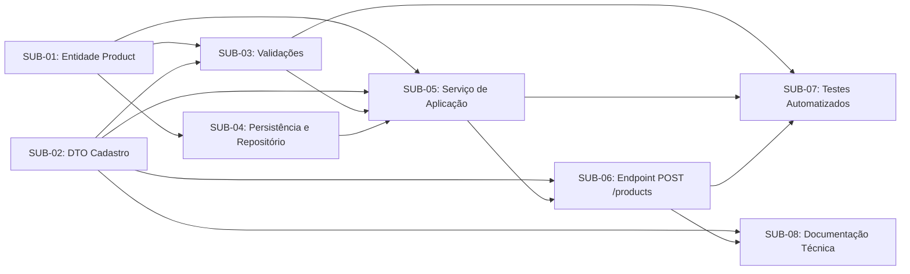

# Planejamento Técnico de Implementação — UC12: Cadastrar Produto

---

## 1. Artefato 1 — Análise Técnica do Caso de Uso

### 1.1 Identificação e Título
- **Código:** UC12
- **Título:** Cadastrar Produto
- **Sistema:** CeliLac
- **Módulo:** Gerenciamento de Produtos
- **Tipo:** Caso de uso funcional

### 1.2 Objetivo e Escopo
- **Objetivo (Confirmado):** Permitir o cadastro de produtos na plataforma CeliLac mediante recebimento, validação e persistência das informações necessárias à criação de um novo produto, respeitando as regras de negócio e impedindo o armazenamento de registros inválidos.
- **Escopo Funcional (Confirmado):** Recepção da requisição de cadastro, validação estrutural dos dados e das regras de negócio aplicáveis ao produto, processamento pelo serviço de aplicação, armazenamento via repositório e retorno do resultado da operação (sucesso ou falha).
- **Fora do Escopo desta Etapa:** Implementação de código-fonte, criação de branches, abertura de Pull Requests, merges ou execução de testes.

### 1.3 Atores
| Ator | Papel / Responsabilidade | Status na Documentação |
| :--- | :--- | :--- |
| **Usuário autorizado a cadastrar produtos** | Solicita o cadastro de um novo produto informando seus dados. | **Pendente de confirmação:** A identificação exata do perfil de usuário e o modelo de permissões precisam ser confirmados na especificação original. |

### 1.4 Pré-condições e Pós-condições
- **Pré-condições (Propostas na documentação — sujeitas à confirmação):**
  1. O sistema CeliLac deve estar operacional.
  2. O usuário deve possuir permissão para realizar o cadastro.
  3. Os serviços necessários ao processamento do cadastro devem estar disponíveis.
- **Pós-condições em Caso de Sucesso (Confirmadas):**
  1. O produto é cadastrado.
  2. As informações válidas são persistidas.
  3. O sistema disponibiliza uma resposta indicando o resultado da operação.
- **Pós-condições em Caso de Falha (Confirmadas):**
  1. O cadastro não é concluído.
  2. Produtos com informações inválidas não são armazenados.
  3. O sistema comunica a falha conforme o contrato da aplicação.

### 1.5 Síntese dos Fluxos
| Fluxo | Tipo | Descrição Resumida | Status na Documentação |
| :--- | :--- | :--- | :--- |
| **Fluxo Principal (FP)** | Principal | 1. Ator solicita cadastro → 2. Sistema recebe dados → 3. Aplicação verifica dados → 4. Sistema executa regras/validações → 5. Serviço processa solicitação → 6. Repositório persiste produto → 7. Sistema retorna resultado. | Proposto a partir dos componentes do material didático. |
| **FA01 — Nome obrigatório não informado** | Alternativo | Solicitação sem nome obrigatório → Validação identifica ausência → Sistema rejeita cadastro → Nenhum produto inválido é armazenado. | Exemplo do material didático; exige confirmação na especificação original. |
| **FA02 — Preço inválido** | Alternativo | Solicitação com preço inválido → Validação identifica inconsistência → Cadastro é rejeitado → Nenhum produto inválido é armazenado. | Ilustrativo; valores permitidos/proibidos não especificados. |
| **FE01 — Falha na persistência** | Exceção | Tentativa de armazenamento sofre falha → Aplicação trata falha conforme arquitetura/contratos → Sistema informa que a operação não foi concluída. | Proposta técnica; não explicitamente documentada como regra original. |

### 1.6 Regras de Negócio e Validações
| Identificador | Descrição | Classificação |
| :--- | :--- | :--- |
| **RN01 — Nome obrigatório** | O produto deve possuir um nome válido. | Candidata à confirmação (critérios de formato/tamanho pendentes). |
| **RN02 — Validação do preço** | O preço deve atender às restrições definidas pelo domínio. | Candidata à confirmação (limites numéricos/regras de valor pendentes). |
| **RN03 — Integridade do cadastro** | Produtos que não atendam às regras de validação não devem ser persistidos. | Confirmada pelo objetivo do caso de uso. |
| **RN04 — Persistência após validação** | O armazenamento deverá ocorrer somente quando as condições necessárias ao cadastro forem atendidas. | Confirmada pelo objetivo e pós-condições. |
| **Validações Gerais** | Validação de campos obrigatórios, dados recebidos, regras de negócio, rejeição de solicitações inválidas, prevenção de persistência inválida e tratamento de falhas. | Confirmadas como escopo de planejamento; restrições exatas de formato, tamanho, valores e unicidade pendentes. |

### 1.7 Requisitos Funcionais Associados
- **RF01 — Cadastro de produto:** Disponibilizar operação para cadastrar produtos conforme regras do UC12.
- **RF02 — Validação das informações:** Verificar informações necessárias à criação do produto.
- **RF03 — Persistência:** Permitir o armazenamento dos produtos cadastrados com sucesso.
- **RF04 — Rejeição de cadastros inválidos:** Impedir que produtos fora dos critérios de validação sejam cadastrados.
- **RF05 — Resposta da operação:** Disponibilizar resposta compatível com o resultado do processamento.

### 1.8 Componentes Potencialmente Envolvidos e Considerações Arquiteturais
Com base na seção 11 da documentação enviada, os componentes candidatos para suportar o UC12 são:
1. **Camada de Domínio:** Entidade `Product` e regras de integridade associadas.
2. **Camada de Aplicação / Contratos:** DTO de cadastro de produto (entrada/saída), serviço de aplicação responsável pela orquestração do cadastro e mecanismos de validação.
3. **Camada de Infraestrutura / Persistência:** Repositório de produtos e configuração de persistência.
4. **Camada de Interface HTTP (Apresentação/API):** Endpoint `POST /products`.
5. **Qualidade e Documentação:** Suíte de testes automatizados e documentação técnica da API/módulo.

### 1.9 Diferenciação: Requisitos Documentados vs. Decisões Técnicas Propostas vs. Dúvidas Identificadas
| Categoria | Itens |
| :--- | :--- |
| **Comportamentos e Componentes Documentados no Material** | Objetivo do UC12, pós-condições de sucesso e falha, RF01 a RF05, CA01 a CA04, entidade `Product`, DTO de cadastro, serviço de aplicação, repositório de produtos, configuração de persistência, validações, endpoint `POST /products`, testes automatizados e atualização de documentação. |
| **Propostas / Hipóteses Técnicas (Sujeitas à Confirmação)** | Pré-condições (sistema operacional, permissão do ator, disponibilidade de serviços), sequência detalhada do Fluxo Principal em 7 passos, FA01 (ausência de nome), FA02 (preço inválido), FE01 (tratamento de falha na persistência) e RN01 a RN04. |
| **Restrições e Dúvidas Pendentes de Confirmação** | 1. Lista completa de atributos da entidade `Product` além de nome e preço.<br>2. Regras exatas de formato, tamanho mínimo/máximo e unicidade para o nome.<br>3. Critérios exatos de validade para o preço (ex.: maior que zero, casas decimais).<br>4. Identificação exata do ator e mecanismo de autenticação/autorização exigido.<br>5. Códigos de status HTTP e estrutura exata do payload de resposta/erro no contrato da aplicação. |

---

## 2. Artefato 2 — Decomposição em Unidades de Trabalho

Para evitar fragmentação artificial e manter alta coesão técnica, as 9 possibilidades listadas na seção 11 da documentação foram consolidadas em **8 unidades de trabalho (Sub-Issues)** bem delimitadas (unificando a implementação do repositório e a configuração de persistência na mesma unidade de infraestrutura de dados, caso pertençam ao mesmo contexto técnico, ou mantendo a separação clara por responsabilidade arquitetural). Abaixo estão as **8 unidades de trabalho** propostas:

| ID Provisório | Nome da Atividade | Objetivo | Escopo | Componente ou Camada | Requisito de Origem | Dependências | Critério Geral de Conclusão |
| :--- | :--- | :--- | :--- | :--- | :--- | :--- | :--- |
| **SUB-01** | Modelar entidade de domínio `Product` | Representar o conceito de Produto no domínio da aplicação. | Definição da estrutura da entidade `Product` e de seus atributos essenciais conforme especificação do UC12. | Domínio (`Product`) | RF01, RN01, RN02 | Nenhuma | Entidade `Product` definida e apta a representar os dados do produto no domínio. |
| **SUB-02** | Definir DTOs e contratos de dados para cadastro de produto | Estabelecer a estrutura de entrada e saída de dados da operação de cadastro. | Criação do DTO de requisição de cadastro e definição da estrutura de resposta da operação. | Aplicação / Contratos (DTO) | RF01, RF05 | Nenhuma | Contratos de entrada e saída definidos para tráfego de dados entre camadas. |
| **SUB-03** | Implementar validações de dados e regras de negócio do cadastro | Garantir que dados inválidos sejam identificados e rejeitados antes da persistência. | Verificação de campos obrigatórios (RN01/FA01), validação de preço (RN02/FA02) e bloqueio de dados inválidos (RN03). | Aplicação / Domínio (Validações) | RF02, RF04, RN01, RN02, RN03, FA01, FA02, CA02 | SUB-01, SUB-02 | Mecanismo de validação rejeitando solicitações sem nome obrigatório ou com preço inválido. |
| **SUB-04** | Configurar persistência e implementar repositório de produtos | Prover o mecanismo de armazenamento de produtos válidos. | Configuração do mapeamento/persistência da entidade `Product` e implementação do repositório responsável por salvar o produto. | Infraestrutura / Persistência (Repositório) | RF03, FE01 | SUB-01 | Repositório implementado e configurado para persistir instâncias válidas de `Product`. |
| **SUB-05** | Implementar serviço de aplicação para cadastro de produto | Orquestrar o fluxo de cadastro de produto integrando validação e persistência. | Recebimento dos dados no serviço, acionamento das validações, chamada ao repositório somente quando válido (RN04) e tratamento de falhas (FE01). | Aplicação (Serviço de Aplicação) | RF01, RF02, RF03, RF04, RN03, RN04, FP, FE01, CA01, CA03 | SUB-01, SUB-02, SUB-03, SUB-04 | Serviço de aplicação processando cadastros válidos e impedindo a persistência de cadastros rejeitados. |
| **SUB-06** | Implementar endpoint HTTP `POST /products` | Expor a operação de cadastro de produtos na interface HTTP da aplicação. | Recepção da requisição em `POST /products`, encaminhamento ao serviço de aplicação e retorno da resposta compatível com o resultado (sucesso ou falha). | Interface HTTP (Controller / Rota) | RF01, RF05, FP, FA01, FA02, FE01 | SUB-02, SUB-05 | Endpoint `POST /products` recebendo requisições e retornando respostas de acordo com o resultado do processamento. |
| **SUB-07** | Implementar testes automatizados do caso de uso UC12 | Verificar de forma automatizada os comportamentos especificados para o cadastro de produtos. | Criação de testes cobrindo o cadastro com dados válidos (CA01), rejeição por ausência de nome (CA02/FA01), validação de preço (FA02) e não persistência de inválidos (CA03). | Testes Automatizados | RF01 a RF05, CA01, CA02, CA03, CA04, FP, FA01, FA02 | SUB-03, SUB-05, SUB-06 | Suíte de testes automatizados implementada e cobrindo os critérios CA01 a CA04. |
| **SUB-08** | Atualizar documentação técnica do cadastro de produtos | Documentar o contrato do endpoint `POST /products`, regras confirmadas e estruturas de dados. | Registro técnico da rota `POST /products`, payloads de entrada/saída, regras de validação aplicadas e comportamentos de erro. | Documentação Técnica | RF01, RF05 | SUB-06 | Documentação técnica atualizada e alinhada ao contrato implementado para o UC12. |

---

## 3. Artefato 3 — Issue Principal (Epic)

Copie o bloco Markdown abaixo para criar a Issue principal no GitHub:

```markdown
# [UC12] Cadastrar Produto

## Objetivo
Permitir o cadastro de produtos na plataforma CeliLac, por meio do recebimento, da validação e da persistência das informações necessárias à criação de um novo produto, respeitando as regras de negócio estabelecidas e impedindo o armazenamento de informações inválidas.

## Contexto
Esta Issue principal (Epic) organiza o planejamento técnico de implementação do caso de uso **UC12 — Cadastrar Produto**, pertencente ao módulo de **Gerenciamento de Produtos** do sistema **CeliLac**. O planejamento decompõe o caso de uso em unidades de trabalho rastreáveis, cobrindo modelagem de domínio, contratos (DTOs), validações, persistência, serviço de aplicação, endpoint HTTP (`POST /products`), testes automatizados e documentação técnica.

## Escopo
- Modelagem da entidade `Product`.
- Definição do DTO e contratos de entrada/saída para o cadastro de produto.
- Implementação das validações de campos obrigatórios e regras de negócio (incluindo validação de nome e preço).
- Configuração da persistência e implementação do repositório de produtos.
- Implementação do serviço de aplicação responsável por coordenar o fluxo de cadastro.
- Criação do endpoint `POST /products`.
- Implementação de testes automatizados para verificação dos fluxos principal e alternativos.
- Atualização da documentação técnica da operação.

## Referência ao Caso de Uso
- **Código:** UC12
- **Nome:** Cadastrar Produto
- **Sistema:** CeliLac
- **Módulo:** Gerenciamento de Produtos
- **Ator Principal:** Usuário autorizado a cadastrar produtos *(permissões e perfil exato pendentes de confirmação na especificação original)*.

## Requisitos, Fluxos e Regras Contemplados
### Requisitos Funcionais
- **RF01 — Cadastro de produto:** Disponibilizar operação para cadastrar produtos conforme as regras do UC12.
- **RF02 — Validação das informações:** Verificar as informações necessárias à criação do produto.
- **RF03 — Persistência:** Permitir o armazenamento dos produtos cadastrados com sucesso.
- **RF04 — Rejeição de cadastros inválidos:** Impedir que produtos que não atendam aos critérios de validação sejam cadastrados.
- **RF05 — Resposta da operação:** Disponibilizar resposta compatível com o resultado do processamento.

### Regras de Negócio (Candidatas à confirmação na especificação original)
- **RN01 — Nome obrigatório:** O produto deve possuir um nome válido.
- **RN02 — Validação do preço:** O preço deve atender às restrições definidas pelo domínio.
- **RN03 — Integridade do cadastro:** Produtos que não atendam às regras de validação não devem ser persistidos.
- **RN04 — Persistência após validação:** O armazenamento deverá ocorrer somente quando as condições necessárias ao cadastro forem atendidas.

### Fluxos Mapeados
- **FP:** Fluxo principal de cadastro de produto (recebimento, validação, processamento pelo serviço, persistência pelo repositório e retorno do resultado).
- **FA01:** Nome obrigatório não informado (rejeição sem persistência).
- **FA02:** Preço inválido (rejeição sem persistência).
- **FE01:** Falha na persistência (tratamento da falha e retorno informando não conclusão).

## Relação das Sub-Issues Planejadas
- [ ] **SUB-01:** `[UC12][Domínio] Modelar entidade Product`
- [ ] **SUB-02:** `[UC12][Contratos] Criar DTO de cadastro de produto`
- [ ] **SUB-03:** `[UC12][Validação] Implementar validações de dados e regras de negócio do produto`
- [ ] **SUB-04:** `[UC12][Persistência] Configurar persistência e implementar repositório de produtos`
- [ ] **SUB-05:** `[UC12][Aplicação] Implementar serviço de aplicação para cadastro de produto`
- [ ] **SUB-06:** `[UC12][HTTP] Criar endpoint POST /products`
- [ ] **SUB-07:** `[UC12][Testes] Implementar testes automatizados para o cadastro de produto`
- [ ] **SUB-08:** `[UC12][Documentação] Atualizar documentação técnica do cadastro de produtos`

## Critérios Gerais de Aceite
- [ ] **CA01:** Uma solicitação contendo dados válidos deve resultar no cadastro de um produto.
- [ ] **CA02:** Uma solicitação sem o nome obrigatório deve ser rejeitada.
- [ ] **CA03:** Uma solicitação rejeitada não deve produzir o armazenamento de um produto inválido.
- [ ] **CA04:** Os comportamentos especificados devem possuir testes automatizados.
- [ ] **CA05:** O sistema deve retornar uma resposta compatível com o resultado da operação (sucesso ou falha).

## Dependências Relevantes e Pontos de Confirmação
- **Confirmação de Especificação:** Confirmar na especificação original do projeto CeliLac a lista completa de atributos de `Product`, os critérios exatos de validade de nome (RN01) e preço (RN02), e as permissões do ator principal.
- **Ordem Técnica:** A implementação do serviço de aplicação (`SUB-05`) depende das definições de domínio (`SUB-01`), DTO (`SUB-02`), validações (`SUB-03`) e repositório (`SUB-04`). O endpoint `POST /products` (`SUB-06`) depende do DTO (`SUB-02`) e do serviço (`SUB-05`).

## Condições de Conclusão
1. Todas as Sub-Issues (`SUB-01` a `SUB-08`) implementadas, revisadas e concluídas.
2. Critérios de aceite gerais (`CA01` a `CA05`) integralmente verificados por testes automatizados.
3. Documentação técnica atualizada no repositório.
```

---

## 4. Artefato 4 — Sub-Issues Completas

Cada bloco abaixo corresponde a uma Sub-Issue individual pronta para criação no GitHub.

### Sub-Issue 1 (SUB-01)

```markdown
# [UC12][Domínio] Modelar entidade Product

## 1. Objetivo
Criar a entidade de domínio `Product` para representar os dados e a estrutura fundamental de um produto no sistema CeliLac.

## 2. Descrição Detalhada
Implementar a classe/estrutura da entidade `Product` na camada de domínio do projeto, contemplando os atributos necessários ao cadastro de produtos conforme o caso de uso UC12 (como nome e preço, além de identificador e demais atributos que sejam confirmados na especificação original do projeto).

> **Nota técnica:** Confirmar na especificação original do UC12 a lista exata de atributos e tipos de dados da entidade antes de finalizar a codificação.

## 3. Requisito ou Fluxo de Origem
- **Requisitos:** RF01 (Cadastro de produto).
- **Regras de Negócio:** RN01 (Nome obrigatório), RN02 (Validação do preço).
- **Considerações Arquiteturais:** Item 1 ("Criar a entidade `Product`").

## 4. Escopo e Responsabilidades
- Definir a entidade `Product` na camada de domínio.
- Declarar os atributos pertinentes ao produto.
- Garantir o encapsulamento e a tipagem adequada dos atributos.
- **Fora do escopo:** Persistência em banco de dados, mapeamento HTTP ou criação de endpoints.

## 5. Critérios de Aceite Verificáveis
- [ ] A entidade `Product` está definida na camada de domínio seguindo o padrão arquitetural do projeto CeliLac.
- [ ] A entidade contempla os atributos necessários para armazenar nome e preço (e demais atributos confirmados na especificação original).
- [ ] A entidade pode ser instanciada pelas camadas de aplicação e persistência sem dependências indevidas da camada de interface HTTP.

## 6. Dependências
- **Dependências técnicas de outras Sub-Issues:** Nenhuma.
- **Pontos de confirmação:** Confirmação dos atributos completos da entidade na especificação original.

## 7. Labels Sugeridas
`uc12`, `type:feature`, `layer:domain`, `priority:high`

## 8. Responsável
A definir

## 9. Estado Inicial Recomendado no Board
`Ready` (ou `Backlog` caso a lista final de atributos na especificação original ainda esteja pendente de confirmação pela equipe).

## 10. Evidências Esperadas para Futura Verificação da Conclusão
- Arquivo de código-fonte da entidade `Product` versionado no repositório.
- Referência ao Pull Request que adicionou a entidade e aprovação em revisão de código.
```

### Sub-Issue 2 (SUB-02)

```markdown
# [UC12][Contratos] Criar DTO de cadastro de produto

## 1. Objetivo
Definir o Objeto de Transferência de Dados (DTO) responsável por representar os dados de entrada recebidos na solicitação de cadastro e a estrutura de saída retornada pela operação.

## 2. Descrição Detalhada
Criar o contrato de dados (DTO) utilizado para receber as informações de um novo produto na aplicação e para estruturar a resposta da operação de cadastro, desacoplando a representação externa (HTTP) da entidade interna de domínio (`Product`).

## 3. Requisito ou Fluxo de Origem
- **Requisitos:** RF01 (Cadastro de produto), RF05 (Resposta da operação).
- **Fluxo Principal:** Passo 2 ("O sistema recebe os dados necessários ao cadastro") e Passo 7 ("O sistema retorna o resultado do cadastro").
- **Considerações Arquiteturais:** Item 2 ("Criar o DTO de cadastro de produto").

## 4. Escopo e Responsabilidades
- Criar a estrutura do DTO de entrada para o cadastro de produto.
- Definir a estrutura de dados de retorno da operação de cadastro (sucesso e comunicação de falha conforme contrato da aplicação).
- **Fora do escopo:** Persistência no repositório ou implementação de rotas HTTP.

## 5. Critérios de Aceite Verificáveis
- [ ] O DTO de cadastro de produto possui os campos necessários para receber os dados do produto (incluindo nome e preço).
- [ ] A estrutura de resposta representa adequadamente o resultado da operação conforme exigido por RF05 e pelas pós-condições do UC12.
- [ ] Os contratos de entrada e saída não expõem detalhes internos de infraestrutura/persistência.

## 6. Dependências
- **Dependências técnicas de outras Sub-Issues:** Nenhuma (pode ser elaborada em paralelo à `SUB-01`, desde que alinhada aos atributos confirmados do produto).

## 7. Labels Sugeridas
`uc12`, `type:feature`, `layer:application`, `priority:high`

## 8. Responsável
A definir

## 9. Estado Inicial Recomendado no Board
`Ready`

## 10. Evidências Esperadas para Futura Verificação da Conclusão
- Arquivo(s) do DTO de cadastro de produto no repositório.
- Pull Request vinculado demonstrando a definição dos contratos de entrada e saída.
```

### Sub-Issue 3 (SUB-03)

```markdown
# [UC12][Validação] Implementar validações de dados e regras de negócio do produto

## 1. Objetivo
Implementar os mecanismos de verificação dos dados recebidos e validação das regras de negócio aplicáveis ao cadastro de produto, garantindo a rejeição de solicitações inválidas.

## 2. Descrição Detalhada
Desenvolver a lógica de validação responsável por verificar a presença dos campos obrigatórios e a conformidade dos atributos do produto com as regras de negócio do UC12. Deve contemplar explicitamente a obrigatoriedade do nome (RN01 / FA01) e a validação do preço (RN02 / FA02), impedindo que dados inválidos prossigam para armazenamento (RN03).

> **Nota técnica:** Os critérios exatos de formato, tamanho e faixas de valores permitidos para o nome e para o preço devem ser confirmados na especificação original do UC12 antes da codificação.

## 3. Requisito ou Fluxo de Origem
- **Requisitos:** RF02 (Validação das informações), RF04 (Rejeição de cadastros inválidos).
- **Regras de Negócio:** RN01 (Nome obrigatório), RN02 (Validação do preço), RN03 (Integridade do cadastro).
- **Fluxos:** FP (Passos 3 e 4), FA01 (Nome obrigatório não informado), FA02 (Preço inválido).
- **Critérios Gerais de Aceite:** CA02.
- **Considerações Arquiteturais:** Item 6 ("Implementar as validações").

## 4. Escopo e Responsabilidades
- Implementar a validação de obrigatoriedade e validade do nome do produto (RN01 / FA01).
- Implementar a validação das restrições de domínio para o preço do produto (RN02 / FA02).
- Implementar a sinalização/retorno de erro ou exceção de validação quando os dados forem inválidos, permitindo que a aplicação rejeite o cadastro.
- **Fora do escopo:** Configuração de banco de dados.

## 5. Critérios de Aceite Verificáveis
- [ ] Solicitações sem o nome obrigatório são identificadas como inválidas e rejeitadas (CA02 / FA01 / RN01).
- [ ] Solicitações com preço fora das restrições definidas pelo domínio são identificadas como inválidas e rejeitadas (FA02 / RN02).
- [ ] Solicitações contendo todos os dados válidos passam pela validação sem erros.
- [ ] A rejeição na validação fornece informações suficientes para que a aplicação comunique a falha conforme seu contrato.

## 6. Dependências
- **Dependências técnicas de outras Sub-Issues:** Depende de `SUB-01` (entidade `Product`) e/ou `SUB-02` (DTO de cadastro), conforme a camada onde as validações forem aplicadas na arquitetura do projeto.
- **Pontos de confirmação:** Definição exata dos limites de preço e regras de formato/tamanho do nome na especificação original.

## 7. Labels Sugeridas
`uc12`, `type:feature`, `layer:domain`, `layer:application`, `priority:high`

## 8. Responsável
A definir

## 9. Estado Inicial Recomendado no Board
`Backlog` (transiciona para `Ready` após a conclusão de `SUB-01`/`SUB-02` e confirmação das restrições exatas de nome e preço).

## 10. Evidências Esperadas para Futura Verificação da Conclusão
- Código-fonte dos validadores/regras de negócio implementados.
- Testes unitários demonstrando a aprovação de dados válidos e a rejeição para FA01 (sem nome) e FA02 (preço inválido).
```

### Sub-Issue 4 (SUB-04)

```markdown
# [UC12][Persistência] Configurar persistência e implementar repositório de produtos

## 1. Objetivo
Configurar o mecanismo de persistência de dados para a entidade `Product` e implementar o repositório responsável pelo armazenamento de produtos cadastrados.

## 2. Descrição Detalhada
Realizar a configuração necessária na camada de persistência/infraestrutura para mapear e armazenar a entidade `Product` e implementar o repositório de produtos contendo a operação de criação/salvamento de um novo produto.

## 3. Requisito ou Fluxo de Origem
- **Requisitos:** RF03 (Persistência).
- **Fluxos:** FP (Passo 6: "O repositório realiza a persistência do produto"), FE01 (Falha na persistência).
- **Pós-condições:** Sucesso item 2 ("As informações válidas são persistidas").
- **Considerações Arquiteturais:** Item 4 ("Implementar o repositório de produtos") e Item 5 ("Configurar a persistência").

## 4. Escopo e Responsabilidades
- Configurar o mapeamento/esquema de persistência para `Product` de acordo com a tecnologia adotada no projeto CeliLac.
- Definir o contrato (interface, se aplicável à arquitetura) e a implementação do repositório de produtos.
- Implementar a operação de persistência de um novo produto no repositório.
- **Fora do escopo:** Regras de interface HTTP e exposição de rotas.

## 5. Critérios de Aceite Verificáveis
- [ ] A persistência para a entidade `Product` está devidamente configurada na infraestrutura do projeto.
- [ ] O repositório de produtos disponibiliza o método para salvar um novo produto.
- [ ] Ao receber uma instância válida de `Product`, o repositório persiste suas informações com sucesso (RF03).
- [ ] Eventuais falhas de armazenamento são propagadas de forma tratável para a camada de aplicação (suporte a FE01).

## 6. Dependências
- **Dependências técnicas de outras Sub-Issues:** Depende de `SUB-01` (entidade `Product`). Pode ser executada em paralelo com `SUB-02` e `SUB-03`.

## 7. Labels Sugeridas
`uc12`, `type:feature`, `layer:persistence`, `priority:high`

## 8. Responsável
A definir

## 9. Estado Inicial Recomendado no Board
`Backlog` (transiciona para `Ready` assim que `SUB-01` estiver concluída).

## 10. Evidências Esperadas para Futura Verificação da Conclusão
- Arquivos de configuração de persistência e implementação do repositório de produtos.
- Testes de repositório/integração comprovando a gravação do produto.
```

### Sub-Issue 5 (SUB-05)

```markdown
# [UC12][Aplicação] Implementar serviço de aplicação para cadastro de produto

## 1. Objetivo
Implementar o serviço de aplicação responsável por coordenar o fluxo de cadastro de produtos, integrando a validação dos dados recebidos e o acionamento do repositório de persistência.

## 2. Descrição Detalhada
Desenvolver o serviço de aplicação do UC12 que recebe os dados de cadastro, aciona as validações definidas, garante que o repositório seja chamado exclusivamente quando todas as regras de validação forem atendidas (RN03 e RN04), trata eventuais falhas de persistência (FE01) e retorna o resultado do processamento.

## 3. Requisito ou Fluxo de Origem
- **Requisitos:** RF01, RF02, RF03, RF04, RF05.
- **Regras de Negócio:** RN03 (Integridade do cadastro), RN04 (Persistência após validação).
- **Fluxos:** FP (Passos 3, 4, 5, 6 e 7), FA01, FA02, FE01.
- **Critérios Gerais de Aceite:** CA01, CA02, CA03.
- **Considerações Arquiteturais:** Item 3 ("Implementar o serviço de aplicação responsável pelo cadastro").

## 4. Escopo e Responsabilidades
- Implementar o método de cadastro de produto no serviço de aplicação.
- Coordenar a execução das validações antes de qualquer operação de escrita no repositório.
- Interromper o fluxo e rejeitar a solicitação caso qualquer validação falhe, garantindo que o repositório não seja acionado para dados inválidos.
- Acionar o repositório de produtos para persistir o produto quando os dados forem válidos.
- Tratar falhas oriundas da camada de persistência conforme contratos da aplicação (FE01).

## 5. Critérios de Aceite Verificáveis
- [ ] Quando acionado com dados válidos, o serviço valida os dados, aciona o repositório para persistir o produto e retorna o resultado de sucesso (CA01 / RN04).
- [ ] Quando acionado sem o nome obrigatório (FA01) ou com preço inválido (FA02), o serviço rejeita a operação (CA02).
- [ ] Em qualquer cenário de rejeição por validação, o repositório não é chamado e nenhum produto inválido é armazenado (CA03 / RN03).
- [ ] Caso ocorra uma falha na operação do repositório (FE01), o serviço trata a falha conforme os contratos da aplicação e informa que o cadastro não foi concluído.

## 6. Dependências
- **Dependências técnicas de outras Sub-Issues:** Depende de `SUB-01` (Entidade `Product`), `SUB-02` (DTO), `SUB-03` (Validações) e `SUB-04` (Repositório de produtos).

## 7. Labels Sugeridas
`uc12`, `type:feature`, `layer:application`, `priority:high`

## 8. Responsável
A definir

## 9. Estado Inicial Recomendado no Board
`Backlog`

## 10. Evidências Esperadas para Futura Verificação da Conclusão
- Código-fonte do serviço de aplicação implementado.
- Testes unitários/integração verificando a orquestração do serviço (sucesso, rejeição sem chamada ao repositório e falha de persistência).
```

### Sub-Issue 6 (SUB-06)

```markdown
# [UC12][HTTP] Criar endpoint POST /products

## 1. Objetivo
Expor o endpoint HTTP `POST /products` para permitir que o ator solicite o cadastro de um novo produto e receba uma resposta compatível com o resultado da operação.

## 2. Descrição Detalhada
Implementar a rota/controlador HTTP `POST /products` que recebe a requisição de cadastro, realiza o binding para o DTO de entrada, aciona o serviço de aplicação responsável pelo cadastro e formata a resposta HTTP de sucesso ou de falha (rejeição de validação ou erro de persistência) de acordo com o contrato da aplicação.

> **Nota técnica:** Caso o controle de permissão do ator principal ("Usuário autorizado a cadastrar produtos") seja aplicado na camada HTTP, deve-se confirmar na especificação original qual mecanismo de autenticação/autorização é utilizado pelo projeto CeliLac.

## 3. Requisito ou Fluxo de Origem
- **Requisitos:** RF01 (Cadastro de produto), RF05 (Resposta da operação).
- **Fluxos:** FP (Passo 1, Passo 2 e Passo 7), FA01, FA02, FE01.
- **Pós-condições:** Sucesso item 3 ("O sistema disponibiliza uma resposta indicando o resultado da operação") e Falha item 3 ("O sistema comunica a falha conforme o contrato da aplicação").
- **Considerações Arquiteturais:** Item 7 ("Criar o endpoint `POST /products`").

## 4. Escopo e Responsabilidades
- Configurar a rota `POST /products` na camada de interface HTTP.
- Receber o payload da requisição e repassá-lo ao serviço de aplicação.
- Retornar resposta HTTP indicando sucesso quando o produto for cadastrado.
- Retornar resposta HTTP comunicando a falha quando o cadastro for rejeitado por dados inválidos (FA01, FA02) ou quando ocorrer erro de processamento/persistência (FE01).

## 5. Critérios de Aceite Verificáveis
- [ ] O endpoint `POST /products` está registrado e acessível na camada HTTP da aplicação.
- [ ] Requisições válidas enviadas para `POST /products` resultam no cadastro do produto e retornam resposta indicando sucesso (CA01 / RF05).
- [ ] Requisições sem nome obrigatório (FA01) ou com preço inválido (FA02) enviadas para `POST /products` são rejeitadas, não persistem dados e retornam resposta comunicando a falha (CA02 / CA03 / RF04 / RF05).
- [ ] Falhas na persistência (FE01) resultam em resposta HTTP informando que a operação não foi concluída, respeitando o contrato da aplicação.

## 6. Dependências
- **Dependências técnicas de outras Sub-Issues:** Depende de `SUB-02` (DTO de cadastro) e `SUB-05` (Serviço de aplicação).
- **Pontos de confirmação:** Confirmação dos códigos de status HTTP padronizados no projeto e da regra de permissão/autorização do ator.

## 7. Labels Sugeridas
`uc12`, `type:feature`, `layer:http`, `priority:medium`

## 8. Responsável
A definir

## 9. Estado Inicial Recomendado no Board
`Backlog`

## 10. Evidências Esperadas para Futura Verificação da Conclusão
- Código-fonte do controlador/rota `POST /products`.
- Testes de integração HTTP demonstrando o comportamento do endpoint para payloads válidos e inválidos.
```

### Sub-Issue 7 (SUB-07)

```markdown
# [UC12][Testes] Implementar testes automatizados para o cadastro de produto

## 1. Objetivo
Garantir a verificação automatizada de todos os comportamentos especificados para o caso de uso UC12 (fluxo principal, fluxos alternativos, fluxos de exceção e critérios de aceite).

## 2. Descrição Detalhada
Implementar a suíte de testes automatizados (unitários e/ou de integração, conforme a estratégia de testes do projeto) para validar o cadastro de produto com dados válidos, a rejeição quando o nome obrigatório não é informado, a rejeição quando o preço é inválido, a garantia de que produtos rejeitados não são armazenados e o tratamento de falha na persistência.

## 3. Requisito ou Fluxo de Origem
- **Requisitos:** RF01, RF02, RF03, RF04, RF05.
- **Fluxos:** FP, FA01, FA02, FE01.
- **Critérios Gerais de Aceite:** CA01, CA02, CA03, CA04 ("os comportamentos especificados devem possuir testes automatizados").
- **Considerações Arquiteturais:** Item 8 ("Implementar testes automatizados").

## 4. Escopo e Responsabilidades
- Implementar testes automatizados para o cenário de sucesso (dados válidos resultam em produto cadastrado e persistido — CA01).
- Implementar testes automatizados para o cenário de ausência do nome obrigatório (solicitação rejeitada — CA02 / FA01).
- Implementar testes automatizados para o cenário de preço inválido (solicitação rejeitada — FA02).
- Verificar explicitamente nos testes de rejeição que nenhum registro inválido foi persistido no repositório/banco de dados (CA03 / RN03).
- Implementar teste verificando o comportamento da aplicação diante de falha na persistência (FE01).

## 5. Critérios de Aceite Verificáveis
- [ ] Existe teste automatizado verificando que uma solicitação com dados válidos cadastra e persiste o produto com sucesso (CA01 / CA04).
- [ ] Existe teste automatizado verificando que uma solicitação sem o nome obrigatório é rejeitada (CA02 / CA04).
- [ ] Existe teste automatizado verificando que uma solicitação com preço inválido é rejeitada (FA02 / CA04).
- [ ] Os testes de cenários inválidos comprovam que nenhum produto inválido foi armazenado no repositório (CA03 / CA04).
- [ ] Existe teste automatizado verificando o tratamento de falha na persistência (FE01).
- [ ] Todos os testes implementados executam de forma determinística e passam sem erros.

## 6. Dependências
- **Dependências técnicas de outras Sub-Issues:** Depende de `SUB-03` (Validações), `SUB-05` (Serviço de aplicação) e `SUB-06` (Endpoint `POST /products`) para a cobertura completa de ponta a ponta.

## 7. Labels Sugeridas
`uc12`, `type:test`, `layer:tests`, `priority:high`

## 8. Responsável
A definir

## 9. Estado Inicial Recomendado no Board
`Backlog`

## 10. Evidências Esperadas para Futura Verificação da Conclusão
- Arquivos de testes automatizados versionados no repositório.
- Registro/log de execução da suíte de testes passando integralmente no ambiente local ou pipeline de CI.
```

### Sub-Issue 8 (SUB-08)

```markdown
# [UC12][Documentação] Atualizar documentação técnica do cadastro de produtos

## 1. Objetivo
Atualizar a documentação técnica do projeto CeliLac para registrar o contrato do endpoint `POST /products`, os dados exigidos para o cadastro e as respostas produzidas pela operação.

## 2. Descrição Detalhada
Documentar tecnicamente a operação de cadastro de produtos (UC12), especificando a rota `POST /products`, o formato do payload de requisição (DTO de entrada), as regras de validação aplicadas (nome obrigatório, regras de preço e demais restrições confirmadas), os códigos e formatos de resposta em caso de sucesso e em caso de falha.

## 3. Requisito ou Fluxo de Origem
- **Requisitos:** RF01 (Cadastro de produto), RF05 (Resposta da operação).
- **Pós-condições:** Sucesso item 3 e Falha item 3.
- **Considerações Arquiteturais:** Item 9 ("Atualizar a documentação técnica").

## 4. Escopo e Responsabilidades
- Documentar o endpoint `POST /products` no padrão adotado pelo repositório (ex.: OpenAPI/Swagger, Markdown ou documentação de API do projeto).
- Descrever exemplos de requisição válida, resposta de sucesso e respostas de erro (FA01, FA02, FE01).
- Registrar as regras de negócio e validações aplicadas ao cadastro.

## 5. Critérios de Aceite Verificáveis
- [ ] A documentação técnica descreve o endpoint `POST /products`, incluindo método HTTP e caminho.
- [ ] Os campos do DTO de entrada e suas restrições de obrigatoriedade/validade estão documentados.
- [ ] Os formatos de resposta para sucesso e para falhas de validação/persistência estão descritos e correspondem fielmente ao comportamento implementado.

## 6. Dependências
- **Dependências técnicas de outras Sub-Issues:** Depende da definição de contratos (`SUB-02`) e da consolidação do endpoint HTTP (`SUB-06`).

## 7. Labels Sugeridas
`uc12`, `type:docs`, `layer:docs`, `priority:low`

## 8. Responsável
A definir

## 9. Estado Inicial Recomendado no Board
`Backlog`

## 10. Evidências Esperadas para Futura Verificação da Conclusão
- Arquivos de documentação atualizados no repositório.
- Pull Request revisado confirmando a aderência da documentação ao contrato do endpoint `POST /products`.
```

---

## 5. Artefato 5 — Matriz de Rastreabilidade

A tabela abaixo relaciona cada requisito, regra de negócio, fluxo e critério geral do UC12 às Sub-Issues planejadas, seus critérios de aceite e os comportamentos que serão verificados futuramente:

| Item do Caso de Uso (Requisito / Regra / Fluxo / Critério) | ID da Sub-Issue | Atividade Técnica Correspondente | Critério de Aceite Associado | Comportamento a Ser Verificado Futuramente |
| :--- | :--- | :--- | :--- | :--- |
| **RF01 — Cadastro de produto** | SUB-01, SUB-02, SUB-05, SUB-06, SUB-08 | Modelagem de `Product`, criação de DTO, serviço de aplicação, endpoint `POST /products` e documentação. | Entidade, DTO, serviço e rota `POST /products` implementados e integrados (CA01). | Envio de requisição `POST /products` com dados válidos cadastra o produto no sistema. |
| **RF02 — Validação das informações** | SUB-03, SUB-05, SUB-07 | Implementação das validações de dados/regras e acionamento no serviço de aplicação. | Dados recebidos são validados quanto a campos obrigatórios e regras de domínio antes da persistência. | Dados de entrada passam pelo validador; inconsistências são detectadas imediatamente. |
| **RF03 — Persistência** | SUB-04, SUB-05, SUB-07 | Configuração de persistência, implementação do repositório e chamada pelo serviço. | Repositório configurado e salvando instâncias válidas de `Product` (CA01). | Produto válido enviado no cadastro é efetivamente gravado e recuperável na camada de persistência. |
| **RF04 — Rejeição de cadastros inválidos** | SUB-03, SUB-05, SUB-06, SUB-07 | Validação de regras, bloqueio no serviço de aplicação e retorno de erro HTTP. | Solicitações inválidas são rejeitadas e não acionam a gravação no repositório (CA02, CA03). | Tentativa de cadastro com dados inválidos retorna erro e mantém o armazenamento inalterado. |
| **RF05 — Resposta da operação** | SUB-02, SUB-06, SUB-08 | Definição do contrato de saída, formatação da resposta no endpoint `POST /products` e documentação. | Endpoint retorna resposta compatível com sucesso ou falha conforme contrato da aplicação. | Cliente HTTP recebe payload/status condizente com o sucesso da criação ou motivo da rejeição/falha. |
| **RN01 — Nome obrigatório** e **FA01 — Nome obrigatório não informado** | SUB-01, SUB-03, SUB-05, SUB-06, SUB-07 | Atributo nome em `Product`, regra de obrigatoriedade na validação e testes automatizados. | Solicitação sem nome obrigatório é rejeitada (CA02) e não armazenada (CA03). | Requisição sem o campo nome (ou com nome vazio/inválido) é rejeitada sem persistir registro. |
| **RN02 — Validação do preço** e **FA02 — Preço inválido** | SUB-01, SUB-03, SUB-05, SUB-06, SUB-07 | Atributo preço em `Product`, validação das restrições de preço e testes automatizados. | Solicitação com preço inválido é rejeitada e não armazenada (CA03). | Requisição com preço violando as regras de domínio é rejeitada sem persistir registro. |
| **RN03 — Integridade do cadastro** | SUB-03, SUB-05, SUB-07 | Bloqueio de fluxo no serviço quando a validação falha e verificação em testes. | Produtos que não atendam às validações não são persistidos (CA03). | Nenhuma chamada de persistência ocorre quando o validador aponta erro. |
| **RN04 — Persistência após validação** | SUB-05, SUB-07 | Ordem de execução no serviço de aplicação (validar antes de persistir). | O repositório somente é acionado após aprovação integral nas validações (CA01, CA03). | Execução sequencial comprovada em teste: validação bem-sucedida precede a chamada ao repositório. |
| **FP — Fluxo Principal (Passos 1 a 7)** | SUB-01 a SUB-07 | Integração completa desde `POST /products` até o repositório e retorno da resposta. | Fluxo completo executa do recebimento HTTP à persistência e resposta (CA01). | Teste de ponta a ponta do fluxo principal concluindo o cadastro com sucesso. |
| **FE01 — Falha na persistência** | SUB-04, SUB-05, SUB-06, SUB-07 | Propagação e tratamento de falha de armazenamento no repositório, serviço e endpoint. | Falha durante a persistência é tratada conforme arquitetura e informa não conclusão da operação. | Simulação de falha no repositório resulta em resposta controlada de erro sem quebra não tratada. |
| **CA01 a CA04 — Critérios Gerais de Aceite** | SUB-03, SUB-05, SUB-06, SUB-07 | Implementação funcional e suíte de testes automatizados (`SUB-07`). | Todos os critérios CA01, CA02, CA03 e CA04 verificados por testes automatizados. | Execução automatizada da suíte de testes aprovando todos os cenários especificados. |

### Análise de Cobertura da Matriz
- **Requisitos sem cobertura:** **Nenhum.** Todos os requisitos (RF01 a RF05), regras (RN01 a RN04), fluxos (FP, FA01, FA02, FE01), critérios de aceite (CA01 a CA04) e os 9 itens arquiteturais da seção 11 possuem cobertura direta nas Sub-Issues `SUB-01` a `SUB-08`.
- **Atividades sem justificativa no caso de uso:** **Nenhuma.** Todas as 8 Sub-Issues derivam exclusivamente das informações fornecidas na documentação do UC12.
- **Observação sobre o Ator e Pré-condição 2 (Permissão de acesso):** Como a própria documentação ressalta que a identificação exata do ator e suas permissões precisam ser confirmadas na especificação original, essa verificação foi registrada como ponto de confirmação na Issue principal e na `SUB-06`, evitando inventar um mecanismo de autenticação/autorização não especificado.

---

## 6. Artefato 6 — Matriz de Dependências

A tabela abaixo diferencia as dependências técnicas obrigatórias (bloqueantes) das relações de contexto e indica onde há possibilidade de execução paralela:

| Atividade (Sub-Issue) | Depende Tecnicamente De | Tipo de Relação | Justificativa Técnica | Condição Necessária para Início | Possibilidade de Execução Paralela |
| :--- | :--- | :--- | :--- | :--- | :--- |
| **SUB-01:** Modelar entidade `Product` | Nenhuma | Independente | É a base do modelo de domínio e não depende de outros componentes do UC12. | Confirmação dos atributos básicos do produto. | **Sim.** Pode ser executada em paralelo com `SUB-02`. |
| **SUB-02:** Criar DTO de cadastro de produto | Nenhuma *(relação de contexto com SUB-01)* | Relação de contexto (Não bloqueante) | O DTO representa o contrato de entrada/saída; precisa apenas conhecer quais dados serão trafegados, sem depender do código da entidade estar pronto. | Definição dos campos de entrada e saída do cadastro. | **Sim.** Pode ser executada em paralelo com `SUB-01` e `SUB-04`. |
| **SUB-03:** Implementar validações | `SUB-01` e/ou `SUB-02` | **Dependência Obrigatória** | As regras de validação operam sobre a estrutura do DTO de entrada e/ou da entidade `Product`. | `SUB-01` e `SUB-02` definidas e critérios de nome/preço confirmados. | **Sim, parcial.** Pode ocorrer em paralelo com `SUB-04` após a conclusão de `SUB-01`. |
| **SUB-04:** Configurar persistência e repositório | `SUB-01` | **Dependência Obrigatória** | O mapeamento de persistência e o repositório manipulam diretamente a entidade `Product`. | Entidade `Product` (`SUB-01`) estruturada. | **Sim.** Pode ser executada totalmente em paralelo com `SUB-02` e `SUB-03`. |
| **SUB-05:** Implementar serviço de aplicação | `SUB-01`, `SUB-02`, `SUB-03`, `SUB-04` | **Dependência Obrigatória** | O serviço orquestra a conversão do DTO, o acionamento das validações e a chamada ao repositório de `Product`. | Entidade, DTO, validações e contrato do repositório disponíveis. | **Não** em relação às suas dependências diretas (é o ponto de integração da camada de aplicação). |
| **SUB-06:** Criar endpoint `POST /products` | `SUB-02`, `SUB-05` | **Dependência Obrigatória** | O controlador HTTP recebe o DTO (`SUB-02`) e invoca o serviço de aplicação (`SUB-05`). | DTO de entrada/saída e serviço de aplicação implementados (ou com contrato fechado). | **Sim, parcial.** A estrutura da rota pode ser iniciada com o contrato de `SUB-02`, mas a integração final exige `SUB-05`. |
| **SUB-07:** Implementar testes automatizados | `SUB-03`, `SUB-05`, `SUB-06` | **Dependência Obrigatória** (para execução final) | A verificação completa dos critérios CA01 a CA04 exige que validações, serviço e endpoint estejam implementados. | Componentes alvo dos testes implementados. | **Sim, parcial.** Os testes unitários de validação e serviço podem ser escritos incrementalmente junto com `SUB-03` e `SUB-05`, finalizando os testes de endpoint após `SUB-06`. |
| **SUB-08:** Atualizar documentação técnica | `SUB-02`, `SUB-06` | **Dependência Obrigatória** | A documentação técnica deve refletir fielmente a rota `POST /products` e os contratos de entrada/saída consolidados. | Endpoint `POST /products` e DTOs definidos. | **Sim.** Pode ser elaborada em paralelo com `SUB-07` logo após a definição de `SUB-06`. |



---

## 7. Artefato 7 — Plano de Labels

Conjunto enxuto e sem redundâncias de labels para classificar as Issues do repositório por **caso de uso/domínio**, **tipo de atividade**, **camada arquitetural** e **prioridade**:

| Nome da Label | Categoria | Cor Sugerida (Hex) | Finalidade | Issues nas Quais Será Aplicada |
| :--- | :--- | :--- | :--- | :--- |
| `uc12` | Caso de Uso / Domínio | `#1D76DB` | Identificar todas as Issues pertencentes ao caso de uso UC12 — Cadastrar Produto. | Epic `[UC12]`, `SUB-01` a `SUB-08` |
| `type:epic` | Tipo de Atividade | `#3E4B9E` | Identificar a Issue principal que agrupa as Sub-Issues do caso de uso. | Epic `[UC12]` |
| `type:feature` | Tipo de Atividade | `#0E8A16` | Identificar atividades de construção de estrutura ou funcionalidade do caso de uso. | `SUB-01`, `SUB-02`, `SUB-03`, `SUB-04`, `SUB-05`, `SUB-06` |
| `type:test` | Tipo de Atividade | `#FBCA04` | Identificar atividades dedicadas à implementação de testes automatizados. | `SUB-07` |
| `type:docs` | Tipo de Atividade | `#0075CA` | Identificar atividades de criação ou atualização de documentação técnica. | `SUB-08` |
| `layer:domain` | Camada / Componente | `#5319E7` | Identificar atividades na camada de domínio (entidades e regras de domínio). | `SUB-01`, `SUB-03` |
| `layer:application` | Camada / Componente | `#BFD4F2` | Identificar atividades na camada de aplicação (DTOs, validações de entrada e serviços). | `SUB-02`, `SUB-03`, `SUB-05` |
| `layer:persistence` | Camada / Componente | `#D93F0B` | Identificar atividades na camada de infraestrutura/persistência e repositórios. | `SUB-04` |
| `layer:http` | Camada / Componente | `#C2E0C6` | Identificar atividades na camada de interface HTTP (controllers/endpoints). | `SUB-06` |
| `layer:tests` | Camada / Componente | `#FEF2C0` | Identificar atividades localizadas na suíte de testes automatizados. | `SUB-07` |
| `layer:docs` | Camada / Componente | `#D4C5F9` | Identificar atividades voltadas aos artefatos de documentação do repositório. | `SUB-08` |
| `priority:high` | Prioridade | `#B60205` | Atividades estruturantes ou bloqueantes para o fluxo central e verificação do caso de uso. | Epic `[UC12]`, `SUB-01`, `SUB-02`, `SUB-03`, `SUB-04`, `SUB-05`, `SUB-07` |
| `priority:medium` | Prioridade | `#FBCA04` | Atividades de exposição da interface que dependem do núcleo da aplicação. | `SUB-06` |
| `priority:low` | Prioridade | `#0E8A16` | Atividades de consolidação documental pós-definição de contratos. | `SUB-08` |

---

## 8. Artefato 8 — Planejamento do GitHub Project

### 8.1 Estrutura Conceitual do Board
O GitHub Project deverá ser configurado no formato de **Board** (Quadro Kanban) ou **Table** agrupada pelo campo **Status**, contendo **exatamente os 5 estados obrigatórios** (sem utilizar `No Status` nem `Todo`):

1. **Backlog:** Atividades planejadas que possuem dependências técnicas ainda não concluídas ou que aguardam confirmação de detalhes da especificação original antes de iniciar a implementação.
2. **Ready:** Atividades refinadas, sem dependências técnicas bloqueantes, prontas para serem iniciadas imediatamente pela equipe.
3. **In Progress:** Atividades cuja implementação está em andamento ativo. *(Não utilizado no momento inicial do planejamento).*
4. **In Review:** Atividades com implementação concluída e Pull Request aberto aguardando revisão de código e verificação dos testes. *(Não utilizado no momento inicial do planejamento).*
5. **Done:** Atividades revisadas, com critérios de aceite comprovados por evidências e integradas à branch principal. *(Não utilizado no momento inicial do planejamento).*

### 8.2 Posicionamento Inicial das Issues no GitHub Project

Como esta etapa é exclusivamente de planejamento, todas as Issues iniciam em **`Ready`** (para as unidades de trabalho de base que não dependem de outras Sub-Issues) ou **`Backlog`** (para a Issue principal e para as Sub-Issues que dependem da conclusão das atividades iniciais ou de confirmações da especificação):

| ID / Issue | Título da Issue | Tipo | Responsável | Estado Inicial Recomendado | Justificativa do Estado Inicial |
| :--- | :--- | :--- | :--- | :--- | :--- |
| **EPIC-UC12** | `[UC12] Cadastrar Produto` | Epic (Issue Principal) | A definir | **Backlog** | Issue guarda-chuva cujo ciclo acompanha todas as Sub-Issues vinculadas. |
| **SUB-01** | `[UC12][Domínio] Modelar entidade Product` | Sub-Issue | A definir | **Ready** | Sem dependências técnicas anteriores; ponto de partida da modelagem de domínio. |
| **SUB-02** | `[UC12][Contratos] Criar DTO de cadastro de produto` | Sub-Issue | A definir | **Ready** | Sem dependências técnicas bloqueantes; pode ser iniciada imediatamente em paralelo à `SUB-01`. |
| **SUB-03** | `[UC12][Validação] Implementar validações de dados e regras de negócio do produto` | Sub-Issue | A definir | **Backlog** | Depende das estruturas de `SUB-01`/`SUB-02` e da confirmação dos critérios exatos de validade de nome e preço. |
| **SUB-04** | `[UC12][Persistência] Configurar persistência e implementar repositório de produtos` | Sub-Issue | A definir | **Backlog** | Depende da definição da entidade `Product` (`SUB-01`). |
| **SUB-05** | `[UC12][Aplicação] Implementar serviço de aplicação para cadastro de produto` | Sub-Issue | A definir | **Backlog** | Depende de `SUB-01`, `SUB-02`, `SUB-03` e `SUB-04`. |
| **SUB-06** | `[UC12][HTTP] Criar endpoint POST /products` | Sub-Issue | A definir | **Backlog** | Depende de `SUB-02` e `SUB-05`. |
| **SUB-07** | `[UC12][Testes] Implementar testes automatizados para o cadastro de produto` | Sub-Issue | A definir | **Backlog** | Depende da implementação das unidades funcionais (`SUB-03`, `SUB-05`, `SUB-06`). |
| **SUB-08** | `[UC12][Documentação] Atualizar documentação técnica do cadastro de produtos` | Sub-Issue | A definir | **Backlog** | Depende da definição dos contratos (`SUB-02`) e do endpoint (`SUB-06`). |

---

## 9. Artefato 9 — Distribuição de Responsabilidades

Como a documentação não informou os nomes ou usuários do GitHub dos integrantes da equipe, o campo **Responsável** está registrado como **"A definir"**, acompanhado das orientações de coordenação para facilitar a alocação pela equipe:

| Identificador da Issue | Atividade | Responsável | Dependências | Estado Inicial | Observações sobre Coordenação |
| :--- | :--- | :--- | :--- | :--- | :--- |
| **EPIC-UC12** | `[UC12] Cadastrar Produto` | A definir | `SUB-01` a `SUB-08` | `Backlog` | Recomenda-se atribuir ao líder técnico da entrega ou responsável pelo acompanhamento geral do caso de uso. |
| **SUB-01** | `[UC12][Domínio] Modelar entidade Product` | A definir | Nenhuma | `Ready` | Deve alinhar com o responsável pela `SUB-02` os nomes e tipos exatos dos atributos confirmados na especificação original. |
| **SUB-02** | `[UC12][Contratos] Criar DTO de cadastro de produto` | A definir | Nenhuma | `Ready` | Pode ser atribuída a outro integrante para execução paralela com a `SUB-01`. Deve alinhar o formato do contrato de resposta. |
| **SUB-03** | `[UC12][Validação] Implementar validações de dados e regras de negócio do produto` | A definir | `SUB-01`, `SUB-02` | `Backlog` | Exige confirmação prévia das regras exatas de nome (RN01) e preço (RN02) junto à especificação original. |
| **SUB-04** | `[UC12][Persistência] Configurar persistência e implementar repositório de produtos` | A definir | `SUB-01` | `Backlog` | Assim que `SUB-01` for concluída, pode avançar para `Ready` e ser desenvolvida em paralelo à `SUB-03`. |
| **SUB-05** | `[UC12][Aplicação] Implementar serviço de aplicação para cadastro de produto` | A definir | `SUB-01`, `SUB-02`, `SUB-03`, `SUB-04` | `Backlog` | Atividade integradora central; requer sincronização com os responsáveis por validação (`SUB-03`) e repositório (`SUB-04`). |
| **SUB-06** | `[UC12][HTTP] Criar endpoint POST /products` | A definir | `SUB-02`, `SUB-05` | `Backlog` | Deve observar os padrões de status HTTP e tratamento de erros já adotados pelos demais endpoints do projeto CeliLac. |
| **SUB-07** | `[UC12][Testes] Implementar testes automatizados para o cadastro de produto` | A definir | `SUB-03`, `SUB-05`, `SUB-06` | `Backlog` | Os testes unitários podem ser co-desenvolvidos pelos responsáveis de `SUB-03` e `SUB-05`, ou consolidados por um integrante focado na verificação dos critérios CA01 a CA04. |
| **SUB-08** | `[UC12][Documentação] Atualizar documentação técnica do cadastro de produtos` | A definir | `SUB-02`, `SUB-06` | `Backlog` | Recomenda-se que seja revisada pelo responsável da `SUB-06` para garantir fidelidade ao contrato HTTP implementado. |

---

## 10. Artefato 10 — Roteiro Operacional de Configuração no GitHub

Siga as etapas abaixo, na ordem apresentada, para estruturar manualmente todo o planejamento no GitHub:

### Passo 1 — Acessar o repositório do projeto
1. Acesse o repositório do projeto **CeliLac** no GitHub utilizando sua conta autenticada.
2. Certifique-se de que a aba **Issues** está habilitada nas configurações do repositório (`Settings > General > Features > Issues`).

### Passo 2 — Criar e configurar as Labels (Artefato 7)
1. Navegue até **Issues > Labels** no repositório.
2. Clique em **New label** e cadastre as labels definidas no **Artefato 7** (`uc12`, `type:epic`, `type:feature`, `type:test`, `type:docs`, `layer:domain`, `layer:application`, `layer:persistence`, `layer:http`, `layer:tests`, `layer:docs`, `priority:high`, `priority:medium`, `priority:low`), preenchendo nome, descrição (finalidade) e cor hexadecimal.

### Passo 3 — Criar a Issue principal (Epic)
1. Na aba **Issues**, clique em **New issue**.
2. Copie o título `[UC12] Cadastrar Produto` e o corpo em Markdown do **Artefato 3**.
3. Aplique as labels `uc12`, `type:epic` e `priority:high`.
4. Clique em **Create** (ou **Submit new issue**) e anote o número gerado pelo GitHub (ex.: `#10`).

### Passo 4 — Criar as Sub-Issues (`SUB-01` a `SUB-08`)
1. Para cada uma das 8 Sub-Issues detalhadas no **Artefato 4**, clique em **New issue** (ou utilize o botão **Create sub-issue** diretamente dentro da Issue principal, recurso nativo de Sub-Issues do GitHub).
2. Copie o título padronizado e o conteúdo integral do bloco Markdown correspondente do **Artefato 4**.
3. Clique em **Create** para cada uma das 8 Sub-Issues e anote os números reais gerados pelo GitHub.

### Passo 5 — Vincular as Sub-Issues à Issue principal
1. Abra a Issue principal `[UC12] Cadastrar Produto`.
2. Caso não tenha criado diretamente pelo botão **Add sub-issue**, utilize a seção **Sub-issues** da Issue principal para adicionar cada uma das 8 Issues criadas (`SUB-01` a `SUB-08`), ou edite a lista de tarefas na seção `Relação das Sub-Issues Planejadas` substituindo os identificadores provisórios pelos números reais das Issues no GitHub (ex.: `- [ ] #11`).

### Passo 6 — Inserir e revisar descrições e critérios de aceite
1. Verifique em cada Sub-Issue criada se todos os checkboxes de critérios de aceite (`- [ ] ...`) foram renderizados corretamente como listas de tarefas interativas no GitHub.

### Passo 7 — Documentar dependências entre as Issues
1. Em cada Sub-Issue que possui dependências técnicas (`SUB-03` a `SUB-08`), edite a seção **6. Dependências** para referenciar os números reais das Issues das quais ela depende (ex.: substituir `SUB-01` por `#11`).
2. Se o recurso de relacionamentos nativos do GitHub (*Blocked by* / *Blocking*) estiver disponível na organização/repositório, registre também o bloqueio correspondente.

### Passo 8 — Aplicar as Labels em todas as Sub-Issues
1. Em cada Sub-Issue, selecione no painel lateral direito (**Labels**) exatamente as labels recomendadas na seção 7 da respectiva Sub-Issue (conforme tabela do **Artefato 7**).

### Passo 9 — Criar o GitHub Project
1. Acesse a aba **Projects** do repositório (ou da organização/conta) e clique em **New project**.
2. Selecione o template **Board** (ou **Table**), defina o nome do projeto (ex.: `CeliLac — Planejamento UC12` ou o Project geral da disciplina) e clique em **Create project**.
3. Vincule o Project ao repositório do CeliLac em **Settings > Manage access / Link a repository**.

### Passo 10 — Configurar exatamente os cinco estados do Board
1. No GitHub Project criado, acesse as configurações do campo **Status** (clique em `...` na coluna ou em **Settings > Fields > Status**).
2. Configure as opções de **Status** para que existam **exatamente** as cinco colunas abaixo, nesta ordem:
   - `Backlog`
   - `Ready`
   - `In Progress`
   - `In Review`
   - `Done`
3. Remova ou renomeie colunas padrão como `Todo` e certifique-se de que nenhuma Issue fique na coluna `No Status`.

### Passo 11 — Adicionar as Issues ao Project e definir estados iniciais
1. Adicione a Issue principal (`[UC12] Cadastrar Produto`) e todas as 8 Sub-Issues (`SUB-01` a `SUB-08`) ao GitHub Project.
2. Posicione `SUB-01` e `SUB-02` na coluna **`Ready`**.
3. Posicione a Issue principal e as Sub-Issues `SUB-03`, `SUB-04`, `SUB-05`, `SUB-06`, `SUB-07` e `SUB-08` na coluna **`Backlog`** (conforme o **Artefato 8**).

### Passo 12 — Atribuir responsáveis e revisar a rastreabilidade
1. Assim que a equipe definir a divisão das tarefas, abra cada Issue e preencha o campo **Assignees** com o usuário do GitHub do integrante responsável, atualizando também o item `8. Responsável` na descrição da Issue.
2. Realize uma conferência final utilizando o **Checklist de Validação (Artefato 11)** abaixo.

---

## 11. Artefato 11 — Checklist de Validação

Utilize a lista de verificação abaixo para conferir o planejamento no GitHub antes da entrega acadêmica:

- [ ] **Issue principal corretamente identificada:** A Issue principal segue o padrão `[UC12] Cadastrar Produto` e contém objetivo, contexto, escopo, requisitos, lista de Sub-Issues e critérios gerais de aceite.
- [ ] **Pelo menos cinco Sub-Issues justificadas e vinculadas:** As 8 Sub-Issues (`SUB-01` a `SUB-08`) foram criadas sem decomposição artificial de fases de TDD e estão devidamente vinculadas à Issue principal.
- [ ] **Objetivos e descrições claros:** Todas as Issues possuem objetivo técnico direto, descrição detalhada e delimitação explícita do que está dentro e fora do escopo.
- [ ] **Critérios de aceite verificáveis:** Todas as Sub-Issues possuem critérios de aceite objetivos, testáveis, fundamentados no UC12 e formatados como checkboxes (`- [ ]`).
- [ ] **Dependências documentadas:** As dependências técnicas obrigatórias entre as Sub-Issues estão registradas nas descrições com referência às Issues correspondentes, diferenciadas de atividades paralelizáveis.
- [ ] **Labels coerentes:** As labels de caso de uso (`uc12`), tipo (`type:*`), camada (`layer:*`) e prioridade (`priority:*`) foram criadas no repositório e aplicadas sem redundância.
- [ ] **Responsáveis atribuídos:** O campo *Assignees* (e a seção de responsável de cada Issue) foi atualizado com os membros reais da equipe no GitHub.
- [ ] **GitHub Project configurado:** O Project foi criado e vinculado ao repositório do projeto CeliLac.
- [ ] **Board com exatamente cinco estados:** O campo `Status` do GitHub Project possui exclusivamente os estados `Backlog`, `Ready`, `In Progress`, `In Review` e `Done` (sem `Todo` e sem Issues em `No Status`).
- [ ] **Issues posicionadas adequadamente:** As atividades sem dependências bloqueantes (`SUB-01`, `SUB-02`) estão em `Ready` e as dependentes (`SUB-03` a `SUB-08` e a Issue principal) estão em `Backlog`, sem nenhuma Issue marcada prematuramente como `Done`.
- [ ] **Rastreabilidade com o caso de uso:** Todos os requisitos (RF01–RF05), regras (RN01–RN04), fluxos (FP, FA01, FA02, FE01) e critérios (CA01–CA04) estão cobertos pelas Sub-Issues.
- [ ] **Ausência de atividades desnecessárias:** Nenhuma tarefa fictícia, fora do escopo do UC12 ou separada por etapa Red–Green–Refactor foi incluída.
- [ ] **Planejamento consistente com a arquitetura do projeto:** As Sub-Issues refletem os componentes arquiteturais previstos (Domínio, DTO, Validações, Persistência/Repositório, Serviço de Aplicação, Endpoint HTTP, Testes e Documentação).

---

## 12. Artefato 12 — Relatório de Consistência e Cobertura

### 12.1 Indicadores Quantitativos do Planejamento
| Indicador | Quantidade | Detalhamento |
| :--- | :--- | :--- |
| **Total de Issues planejadas** | **9 Issues** | 1 Issue Principal (Epic) + 8 Sub-Issues técnicas (`SUB-01` a `SUB-08`). |
| **Requisitos funcionais contemplados** | **5 de 5 (100%)** | `RF01`, `RF02`, `RF03`, `RF04` e `RF05`. |
| **Regras de negócio contempladas** | **4 de 4 (100%)** | `RN01`, `RN02`, `RN03` e `RN04`. |
| **Fluxos contemplados** | **4 de 4 (100%)** | `FP` (7 passos), `FA01`, `FA02` e `FE01`. |
| **Critérios gerais de aceite contemplados** | **4 de 4 (100%)** | `CA01`, `CA02`, `CA03` e `CA04`. |
| **Requisitos sem cobertura** | **0** | Todos os itens presentes no documento do UC12 estão mapeados na Matriz de Rastreabilidade. |

### 12.2 Dependências Críticas
1. **Definição da Entidade `Product` (`SUB-01`) e do DTO (`SUB-02`):** São a base estrutural do caso de uso. Qualquer atraso ou indefinição nos atributos dessas duas unidades bloqueia as validações (`SUB-03`), o repositório (`SUB-04`) e o serviço de aplicação (`SUB-05`).
2. **Serviço de Aplicação (`SUB-05`):** É o ponto de convergência arquitetural do UC12, pois depende simultaneamente de `SUB-01`, `SUB-02`, `SUB-03` e `SUB-04`, e bloqueia a conclusão funcional do endpoint `POST /products` (`SUB-06`) e dos testes integrados (`SUB-07`).

### 12.3 Decisões Técnicas Pendentes e Pontos que Exigem Validação do Estudante
Como a documentação enviada explicita que diversos elementos são candidatos à confirmação na especificação original do projeto CeliLac, o estudante e sua equipe devem validar antes de iniciar a codificação:
1. **Atributos completos do Produto:** Confirmar se a entidade `Product` possui outros atributos obrigatórios ou opcionais além de `nome` e `preço` (ex.: descrição, categoria, código/SKU, indicação de restrição alimentar/isento de glúten ou lactose).
2. **Critérios exatos de validação (RN01 e RN02):**
   - Para o **nome**: tamanho mínimo/máximo permitido, caracteres aceitos e se há regra de unicidade (produtos com mesmo nome são proibidos ou permitidos?).
   - Para o **preço**: valor mínimo permitido (ex.: estritamente maior que zero `> 0` ou `>= 0`), precisão decimal e tipo numérico adotado.
3. **Ator e Controle de Acesso (Seção 3 e Pré-condição 2):** Confirmar quem é o "Usuário autorizado a cadastrar produtos" e se o endpoint `POST /products` exige validação de autenticação/autorização (ex.: token JWT/role específica) já existente no projeto ou se a autenticação pertence a outro caso de uso.
4. **Contrato HTTP de Resposta e Erros (RF05, Pós-condições e FE01):** Confirmar os códigos de status HTTP padronizados no projeto CeliLac (ex.: `201 Created` para sucesso, `400 Bad Request` ou `422 Unprocessable Entity` para `FA01`/`FA02`, e `500 Internal Server Error` para `FE01`) e o formato JSON de retorno de erros.
5. **Alocação da Equipe:** Definir os nomes/usuários do GitHub dos integrantes responsáveis por cada uma das Issues (`EPIC-UC12` e `SUB-01` a `SUB-08`).

### 12.4 Riscos de Retrabalho Identificados
- **Risco 1 — Alteração tardia dos atributos de `Product`:** Iniciar a implementação do repositório (`SUB-04`), do serviço (`SUB-05`) e do endpoint (`SUB-06`) sem antes confirmar a lista definitiva de atributos na especificação original pode gerar retrabalho em cascata em todas as camadas e nos testes automatizados.
- **Risco 2 — Divergência nas regras de validação de preço e nome:** Implementar validações arbitrárias na `SUB-03` sem alinhamento com a especificação original pode fazer com que testes automatizados (`SUB-07`) falhem perante os critérios de avaliação da disciplina.
- **Risco 3 — Falta de padronização no contrato de erro:** Se o formato de retorno das rejeições (`FA01` e `FA02`) não for combinado entre os responsáveis por `SUB-02`, `SUB-03`, `SUB-05` e `SUB-06`, haverá incompatibilidade na escrita dos testes de integração (`SUB-07`) e na documentação (`SUB-08`).

### 12.5 Recomendações de Refinamento
1. **Confrontar com a Especificação Original:** Antes de mover `SUB-03` a `SUB-08` de `Backlog` para `Ready`, revise a especificação original do projeto CeliLac e adicione como comentário na Issue principal (`[UC12] Cadastrar Produto`) as regras exatas confirmadas para atributos, nome, preço e status HTTP.
2. **Alinhar Contratos Primeiro:** Priorize a execução conjunta de `SUB-01` e `SUB-02` para congelar os contratos internos e externos do cadastro de produto logo no início do ciclo de desenvolvimento.
3. **Manter o Board Atualizado:** Durante a futura etapa de implementação, mova cada Sub-Issue rigorosamente entre `Ready` → `In Progress` → `In Review` → `Done`, vinculando sempre o respectivo Pull Request e a evidência de execução dos testes antes de concluí-la.