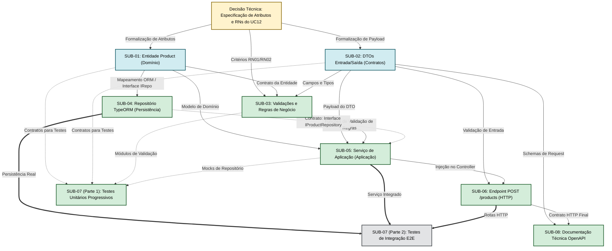

# ARTEFATO 02 — REFINAMENTO DAS DEPENDÊNCIAS TÉCNICAS

> **Aviso de Rastreabilidade e Governança:**
> - **Caso de Uso:** `UC12 — Cadastrar Produto` (Backend CeliLac).
> - **Sub-Issues Preservadas:** `SUB-01` a `SUB-08`.
> - **Objetivo:** Refinar as relações técnicas entre as tarefas, superando a visão ingênua de sequência em cascata estrita (Entidade → Repositório → Serviço → Controller → Testes) e distinguindo dependências de contrato daquelas que exigem implementação prévia.

---

## 2.1 Categorias de Dependências Técnicas

Para modelar com precisão o fluxo de desenvolvimento no ecossistema NestJS/TypeScript, as relações entre as atividades foram classificadas em quatro categorias:

1. **Dependência de Contrato:** A atividade necessita apenas conhecer uma interface TypeScript, estrutura de dados, tipo, DTO ou assinatura de método compartilhada. Não exige a implementação interna do componente colaborador.
2. **Dependência de Implementação:** A atividade necessita que a lógica executável de um componente colaborador esteja pronta e testada para que sua própria funcionalidade possa ser concluída com sucesso.
3. **Dependência de Integração:** Dois ou mais componentes desenvolvidos de forma desacoplada precisam ser plugados no contêiner de Injeção de Dependências (módulos do NestJS) e verificados conjuntamente em ambiente de execução.
4. **Dependência de Decisão:** A atividade depende da formalização de uma decisão arquitetural, semântica de negócio ou padrão de resposta antes que sua especificação ou codificação se consolide.

---

## 2.2 Matriz de Dependências Técnicas Refinadas

| Issue de Origem | Issue Relacionada | Tipo de Dependência | Definição ou Entrega Necessária | Justificativa Técnica | Condição para Início da Atividade | Condição para Conclusão ou Integração | Possibilidade de Paralelismo | Situação da Dependência |
| :--- | :--- | :--- | :--- | :--- | :--- | :--- | :--- | :--- |
| **SUB-01** (Entidade `Product`) | **Documento UC12** | **Dependência de Decisão** | Confirmação dos atributos do produto (nome, descrição, preço, categoria, etc.) | A modelagem da classe de domínio depende da definição formal dos campos do produto na especificação de requisitos. | Aprovação documental dos atributos de produto pela equipe/PO. | Validação da estrutura de tipos em TypeScript. | Não se aplica (atividade de raiz conceitual). | **Pendente de Decisão** *(Aguardando alinhamento da especificação)* |
| **SUB-02** (DTO de Cadastro) | **Documento UC12 / SUB-01** | **Dependência de Decisão e Contrato** | Estrutura de dados de entrada (`CreateProductDto`) e resposta (`ProductResponseDto`) | O DTO define a fronteira externa da API e deve refletir os dados exigidos pelo caso de uso, alinhado à entidade. | Alinhamento com os atributos de `SUB-01` e requisitos de entrada do UC12. | Decorators do `class-validator` e tipos mapeados. | **Sim**, pode avançar em paralelo com `SUB-01` assim que os atributos forem listados. | **Pendente de Decisão** *(Contrato de entrada/saída a formalizar)* |
| **SUB-03** (Validações e Regras) | **SUB-01** e **SUB-02** | **Dependência de Contrato** | Atributos da entidade e campos do DTO; critérios objetivos de `RN01` a `RN04` | As validações atuam sobre as propriedades do DTO e da entidade para garantir o critério de não persistência de dados inválidos (`CA03`). | Especificação dos critérios objetivos das regras `RN01` a `RN04` e tipos de dados. | Conjunto de funções/classes de validação testadas unitariamente com casos de sucesso e falha. | **Sim**, as regras podem ser prototipadas em paralelo à modelagem detalhada. | **Controlada** *(Aguarda detalhamento de limites numéricos)* |
| **SUB-04** (Repositório TypeORM) | **SUB-01** | **Dependência de Contrato** | Assinatura da entidade `Product` e interface `IProductRepository` | O repositório necessita conhecer os campos para mapear no `@Entity()` do TypeORM e definir métodos de persistência. | Interface `IProductRepository` e definição da entidade `Product`. | Mapeamento TypeORM configurado e migração gerada/validada contra o PostgreSQL. | **Sim**, com a interface de repositório acordada, a infraestrutura pode avançar sem depender do Service. | **Controlada** *(Depende de SUB-01)* |
| **SUB-05** (Serviço de Aplicação) | **SUB-01**, **SUB-02**, **SUB-03**, **SUB-04** | **Dependência de Contrato** (para início) e **Integração** (para fechamento) | Interfaces `IProductRepository`, DTOs de entrada/saída e funções de validação | O serviço orquestra o caso de uso. Não precisa do repositório real ou do banco para ser codificado; depende apenas de suas interfaces (Inversão de Dependência - DIP). | Assinaturas de interfaces de repositório, DTOs e regras de negócio disponíveis. | Injeção de dependência configurada no NestJS e testes unitários de fluxo com mocks aprovados. | **Sim**, o serviço pode ser implementado e testado unitariamente via mocks antes da finalização do repositório TypeORM. | **Controlada** *(Depende da consolidação dos contratos prévios)* |
| **SUB-06** (Endpoint `POST /products`) | **SUB-02** | **Dependência de Contrato** | Definição do `CreateProductDto` com validações HTTP | O Controller recebe o payload e valida a requisição HTTP. Não precisa do Service finalizado para ter sua rota e validação estruturadas. | `CreateProductDto` com decorators (`ValidationPipe`). | Tratamento de status codes HTTP (201, 400, 422, 409) e mapeamento de exceções. | **Sim**, o esqueleto da rota e validação sintática do DTO podem ser feitos antes da integração do serviço. | **Controlada** *(Depende de SUB-02)* |
| **SUB-06** (Endpoint `POST /products`) | **SUB-05** | **Dependência de Integração** | Assinatura do método do Service (`execute(dto): Promise<ProductResponseDto>`) | O Controller precisa injetar o serviço para delegar a execução da regra de negócio e retornar a resposta HTTP. | Interface do serviço de aplicação disponível. | Integração do controller com o serviço no `ProductsModule` do NestJS. | Não no momento da integração final (exige método do Service definido). | **Controlada** *(Integração na etapa final do fluxo)* |
| **SUB-07** (Testes Automatizados - Unitários) | **SUB-01**, **SUB-02**, **SUB-03**, **SUB-05** | **Dependência de Contrato** | Interfaces e assinaturas de métodos | Testes unitários (Vitest) podem ser escritos em TDD ou concomitantemente com cada componente isolado, usando dublês de teste (mocks/spies). | Assinatura de métodos e regras de negócio documentadas. | Cobertura de cenários de sucesso e falha (exceções de validação e repositório). | **Sim**, os testes unitários acompanham cada entrega incrementalmente. | **Controlada** *(Execução progressiva)* |
| **SUB-07** (Testes Automatizados - E2E) | **SUB-04**, **SUB-05**, **SUB-06** | **Dependência de Integração** | Módulo `ProductsModule` compilável, banco PostgreSQL ativo e rotas registradas | O teste E2E (Supertest) valida a requisição HTTP completa, persistência real no banco e códigos de resposta (`CA01` a `CA04`). | Todos os componentes do módulo integrados e banco acessível em ambiente de teste. | Bateria de testes E2E executada com sucesso contra o endpoint real. | Não (é a verificação final da cadeia integrada). | **Controlada** *(Execução ao final da integração)* |
| **SUB-08** (Documentação Técnica) | **SUB-02**, **SUB-06** | **Dependência de Contrato e Integração** | Estrutura final dos DTOs, decorators OpenAPI (`@ApiProperty`, `@ApiResponse`) e rota | A documentação técnica (Swagger/OpenAPI e README) reflete o contrato HTTP consumível e exemplos de payload/respostas. | Rota e DTOs definidos na camada de apresentação. | Swagger UI gerando schemas fiéis e documentação de exceções (`400`, `422`, `409`, `500`). | **Sim**, pode ser elaborada em paralelo à implementação dos endpoints via decorators. | **Controlada** *(Atividade de finalização)* |

---

## 2.3 Diagrama de Dependências Técnicas Refinadas

O diagrama abaixo ilustra as relações técnicas efetivamente justificadas, evidenciando como a **Inversão de Dependências (DIP)** e os **Contratos de Dados** permitem desacoplar a arquitetura:

---

## 2.4 Síntese Operacional do Refinamento

1. **Ruptura com o Modelo em Cascata:** Graças à Inversão de Dependências (DIP) no NestJS, o serviço `SUB-05` não necessita que o repositório TypeORM (`SUB-04`) esteja fisicamente conectado ao PostgreSQL para ser desenvolvido. Ele precisa apenas da interface `IProductRepository`.
2. **Desenvolvimento Orientado a Contratos:** Uma vez estabilizados `SUB-01` e `SUB-02`, as tarefas de persistência (`SUB-04`), validação (`SUB-03`) e transporte HTTP (`SUB-06`) tornam-se desacopladas e elegíveis a trabalho paralelo.
3. **Estratégia de Testes Contínuos:** Os testes automatizados (`SUB-07`) deixam de ser uma fase final bloqueante. Eles se iniciam unitariamente sobre cada contrato e culminam na verificação E2E apenas no momento da integração final.

