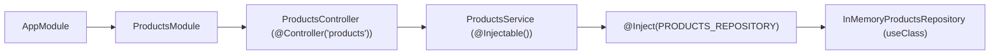

# ARTEFATO 07-04 — CONFIGURAÇÃO DA VALIDAÇÃO E COMPOSIÇÃO DO MÓDULO NESTJS

## 1. Configuração do `ValidationPipe` na Aplicação (`src/main.ts`)

### 1.1 Código Implementado em `src/main.ts`
```typescript
import { ValidationPipe } from '@nestjs/common';
import { NestFactory } from '@nestjs/core';
import { AppModule } from './app.module.js';

async function bootstrap() {
  const app = await NestFactory.create(AppModule);
  app.useGlobalPipes(
    new ValidationPipe({
      whitelist: true,
      transform: true,
    }),
  );
  const port = process.env.PORT || 3200;
  await app.listen(port);

  console.log(`Server is running on http://localhost:${port}`);
}
await bootstrap();
```

### 1.2 Funcionamento Técnico do `ValidationPipe`
1. **Metadados de Validação (`reflect-metadata` + `class-validator`):** Com `emitDecoratorMetadata: true` e `experimentalDecorators: true` ativos no `tsconfig.json`, o NestJS identifica que o parâmetro `@Body() dto: CreateProductDto` de `ProductsController.create` é tipado com a classe `CreateProductDto` e executa as regras declaradas pelos decoradores `@IsString()` e `@IsNotEmpty()`.
2. **`whitelist: true`:** Remove automaticamente do objeto recebido quaisquer propriedades extras que não possuam decoradores de validação declarados no DTO, protegendo a aplicação contra injeção de campos não autorizados (*mass assignment*).
3. **`transform: true`:** Utiliza `class-transformer` (`plainToInstance`) para instanciar o payload JSON desserializado como uma instância real de `CreateProductDto`. *(Nota técnica importante: `transform: true` sem `enableImplicitConversion` **não** converte arbitrariamente tipos primitivos incompatíveis no corpo JSON — por exemplo, um número não é convertido silenciosamente em string para burlar `@IsString()`).*
4. **Rejeição de Entradas Inválidas:** Caso qualquer restrição do DTO seja violada (como `{"name": ""}`), o `ValidationPipe` interrompe o pipeline da requisição antes da execução do método do Controller e responde automaticamente com `400 Bad Request` contendo a lista detalhada de mensagens de erro.

---

## 2. Composição do Módulo NestJS e Resolução de Dependências

### 2.1 Implementação Didática em Memória (`InMemoryProductsRepository`)
Como a persistência real com TypeORM/PostgreSQL pertence ao escopo futuro da `SUB-04` (Issue #7) e não deve ser antecipada nesta unidade, foi implementada uma classe em memória que cumpre estritamente o contrato `ProductsRepository`:

- **Arquivo:** `src/modules/products/repositories/in-memory-products.repository.ts`
```typescript
import { Injectable } from '@nestjs/common';
import { Product } from '../entities/product.entity.js';
import { ProductsRepository } from './products.repository.interface.js';

@Injectable()
export class InMemoryProductsRepository implements ProductsRepository {
  private readonly products: Product[] = [];

  async save(product: Product): Promise<Product> {
    this.products.push(product);
    return product;
  }
}
```
- **Limitação explícita:** Trata-se de uma implementação didática em memória para permitir a composição do módulo e a verificação da fronteira HTTP, não representando a persistência definitiva em banco de dados.

### 2.2 Módulo de Produtos (`ProductsModule`)
- **Arquivo:** `src/modules/products/products.module.ts`
```typescript
import { Module } from '@nestjs/common';
import { ProductsController } from './controllers/products.controller.js';
import { InMemoryProductsRepository } from './repositories/in-memory-products.repository.js';
import { PRODUCTS_REPOSITORY } from './repositories/products.repository.interface.js';
import { ProductsService } from './services/products.service.js';

@Module({
  controllers: [ProductsController],
  providers: [
    ProductsService,
    {
      provide: PRODUCTS_REPOSITORY,
      useClass: InMemoryProductsRepository,
    },
  ],
  exports: [ProductsService],
})
export class ProductsModule {}
```

### 2.3 Integração no Módulo Raiz (`AppModule`)
- **Arquivo:** `src/app.module.ts`
- `ProductsModule` foi adicionado ao array `imports` de `AppModule` (e foi removida a entrada duplicada de `OrdersModule` que existia anteriormente).

### 2.4 Mapa de Resolução de Injeção de Dependências (DI)


---

## 3. Evidência Real de Inicialização da Aplicação

A aplicação foi compilada (`pnpm build`) e inicializada (`node dist/main.js`), comprovando a resolução completa de todos os módulos, providers e rotas sem erros:

```text
[Nest] 71242  - 11/08/2026, 12:33:51 PM     LOG [NestFactory] Starting Nest application...
[Nest] 71242  - 11/08/2026, 12:33:51 PM     LOG [InstanceLoader] TypeOrmModule dependencies initialized +4ms
[Nest] 71242  - 11/08/2026, 12:33:51 PM     LOG [InstanceLoader] ConfigHostModule dependencies initialized +0ms
[Nest] 71242  - 11/08/2026, 12:33:51 PM     LOG [InstanceLoader] ConfigModule dependencies initialized +1ms
[Nest] 71242  - 11/08/2026, 12:33:51 PM     LOG [InstanceLoader] ProductsModule dependencies initialized +19ms
[Nest] 71242  - 11/08/2026, 12:33:51 PM     LOG [InstanceLoader] AppModule dependencies initialized +0ms
[Nest] 71242  - 11/08/2026, 12:33:51 PM     LOG [InstanceLoader] TypeOrmCoreModule dependencies initialized +50ms
[Nest] 71242  - 11/08/2026, 12:33:51 PM     LOG [InstanceLoader] TypeOrmModule dependencies initialized +0ms
[Nest] 71242  - 11/08/2026, 12:33:51 PM     LOG [InstanceLoader] OrdersModule dependencies initialized +0ms
[Nest] 71242  - 11/08/2026, 12:33:51 PM     LOG [RoutesResolver] AppController {/}: +11ms
[Nest] 71242  - 11/08/2026, 12:33:51 PM     LOG [RouterExplorer] Mapped {/, GET} route +1ms
[Nest] 71242  - 11/08/2026, 12:33:51 PM     LOG [RoutesResolver] OrdersController {/orders}: +0ms
[Nest] 71242  - 11/08/2026, 12:33:51 PM     LOG [RouterExplorer] Mapped {/orders/:id/confirm, POST} route +0ms
[Nest] 71242  - 11/08/2026, 12:33:51 PM     LOG [RoutesResolver] ProductsController {/products}: +0ms
[Nest] 71242  - 11/08/2026, 12:33:51 PM     LOG [RouterExplorer] Mapped {/products, POST} route +1ms
[Nest] 71242  - 11/08/2026, 12:33:51 PM     LOG [NestApplication] Nest application successfully started +0ms
Server is running on http://localhost:3200
```

---

## 4. Checklist de Verificação da Composição e Pendências

- [x] **1. Controller registrado:** `ProductsController {/products}` e rota `{/products, POST}` mapeados pelo `RouterExplorer`.
- [x] **2. Serviço disponível:** `ProductsService` instanciado em `ProductsModule`.
- [x] **3. Token resolvido:** Token `PRODUCTS_REPOSITORY` resolvido sem `UnknownDependenciesException`.
- [x] **4. Implementação concreta associada:** `InMemoryProductsRepository` vinculada via `useClass`.
- [x] **5. Módulo corretamente importado:** `ProductsModule` inicializado por `AppModule` (`[InstanceLoader] ProductsModule dependencies initialized +19ms`).
- [x] **6. Validação configurada:** `ValidationPipe` global registrado em `src/main.ts`.
- [x] **7. Aplicação inicializada:** Servidor HTTP ativo em `http://localhost:3200`.
- **Pendências futuras (fora do escopo desta unidade):** Substituir `InMemoryProductsRepository` pelo repositório TypeORM/PostgreSQL quando a `SUB-04` (Issue #7) for implementada.

