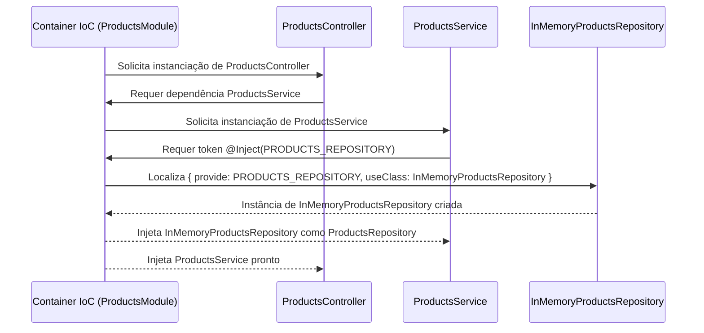

# ARTEFATO 08-03 — VERIFICAÇÃO DE MÓDULOS E PROVIDERS

## 1. Objetivo da Verificação

Inspecionar e comprovar empiricamente a composição do módulo NestJS (`ProductsModule` e `AppModule`), a associação do token de persistência `PRODUCTS_REPOSITORY` à classe concreta `InMemoryProductsRepository` e a resolução completa da árvore de injeção de dependências em tempo de execução.

---

## 2. Componentes Inspecionados e Contratos de Composição

| Item | Componente / Símbolo | Arquivo no Repositório | Papel na Composição NestJS | Status |
| :---: | :--- | :--- | :--- | :---: |
| **1** | **`ProductsModule`** | `src/modules/products/products.module.ts` | Módulo de feature que agrupa controller, service e provider de persistência de produtos. | **Confirmado** |
| **2** | **`ProductsController`** | `src/modules/products/controllers/products.controller.ts` | Registrado em `controllers: [ProductsController]`; declara `@Controller('products')` e `@Post()`. | **Confirmado** |
| **3** | **`ProductsService`** | `src/modules/products/services/products.service.ts` | Registrado em `providers` e `exports` de `ProductsModule`; decorado com `@Injectable()`. | **Confirmado** |
| **4** | **`PRODUCTS_REPOSITORY`** | `src/modules/products/repositories/products.repository.interface.ts` | Token de injeção em tempo de execução (`export const PRODUCTS_REPOSITORY = 'PRODUCTS_REPOSITORY'`). | **Confirmado** |
| **5** | **`InMemoryProductsRepository`** | `src/modules/products/repositories/in-memory-products.repository.ts` | Classe concreta decorada com `@Injectable()` que implementa `ProductsRepository` e é vinculada ao token via `useClass`. | **Confirmado** |
| **6** | **`AppModule`** | `src/app.module.ts` | Módulo raiz que importa `ProductsModule` no array `imports`. | **Confirmado** |
| **7** | **`ValidationPipe`** | `src/main.ts` | Configurado globalmente no bootstrap com `new ValidationPipe({ whitelist: true, transform: true })`. | **Confirmado** |

---

## 3. Inspeção Técnica do Provider Customizado

Em `src/modules/products/products.module.ts`:

```typescript
import { Module } from '@nestjs/common';
import { ProductsController } from './controllers/products.controller.js';
import { InMemoryProductsRepository } from './repositories/in-memory-products.repository.js';
import { PRODUCTS_REPOSITORY } from './repositories/products.repository.interface.js';
import { ProductsService } from './services/products.service.js';

@Module({
  controllers: [ProductsController],
  providers: [
    ProductsService,
    {
      provide: PRODUCTS_REPOSITORY,
      useClass: InMemoryProductsRepository,
    },
  ],
  exports: [ProductsService],
})
export class ProductsModule {}
```

### Por que a interface TypeScript `ProductsRepository` não pode ser usada como token de execução?
Em TypeScript, interfaces (`export interface ProductsRepository`) existem apenas em tempo de compilação para verificação estática de tipos e são completamente removidas (*type erasure*) na transpilação para JavaScript. Por isso, o container de Injeção de Dependências (IoC) do NestJS necessita de um valor existente em tempo de execução — neste caso, a constante string `PRODUCTS_REPOSITORY = 'PRODUCTS_REPOSITORY'` — injetada explicitamente via `@Inject(PRODUCTS_REPOSITORY)` no construtor de `ProductsService`.

---

## 4. Fluxo de Resolução de Dependências no Container IoC do NestJS

Quando o NestJS inicializa `ProductsModule`, a resolução ocorre em 6 passos encadeados:

1. **Criação do Controller:** O NestJS identifica `ProductsController` na lista `controllers` de `ProductsModule` e analisa os metadados de seu construtor (`constructor(private readonly productsService: ProductsService)`).
2. **Injeção do Service no Controller:** O container localiza o provider `ProductsService` registrado no mesmo módulo e antes de instanciá-lo inspeciona suas dependências.
3. **Solicitação do Token `PRODUCTS_REPOSITORY` pelo Service:** O construtor de `ProductsService` declara `@Inject(PRODUCTS_REPOSITORY) private readonly productsRepository: ProductsRepository`, solicitando ao container o provider associado ao token `'PRODUCTS_REPOSITORY'`.
4. **Identificação do Provider Correspondente no Módulo:** O `ProductsModule` possui o registro `{ provide: PRODUCTS_REPOSITORY, useClass: InMemoryProductsRepository }`.
5. **Instanciação de `InMemoryProductsRepository`:** O NestJS instancia a classe concreta `InMemoryProductsRepository` (singleton no escopo do módulo) e a injeta em `ProductsService`.
6. **Desacoplamento Arquitetural:** `ProductsService` invoca `this.productsRepository.save(product)` apoiando-se unicamente no contrato `ProductsRepository`, sem conhecer nem importar `InMemoryProductsRepository`.



---

## 5. Verificação Prática de Compilação e Inicialização

### 5.1 Comandos Executados
1. Compilação TypeScript/NestJS:
   ```bash
   pnpm build
   ```
2. Inicialização da aplicação real compilada:
   ```bash
   node dist/main.js
   ```

### 5.2 Resultado Real Obtido no Terminal
```text
[Nest] 93418  - 11/08/2026, 7:23:37 PM     LOG [NestFactory] Starting Nest application...
[Nest] 93418  - 11/08/2026, 7:23:37 PM     LOG [InstanceLoader] TypeOrmModule dependencies initialized +3ms
[Nest] 93418  - 11/08/2026, 7:23:37 PM     LOG [InstanceLoader] ConfigHostModule dependencies initialized +0ms
[Nest] 93418  - 11/08/2026, 7:23:37 PM     LOG [InstanceLoader] ConfigModule dependencies initialized +1ms
[Nest] 93418  - 11/08/2026, 7:23:37 PM     LOG [InstanceLoader] ProductsModule dependencies initialized +13ms
[Nest] 93418  - 11/08/2026, 7:23:37 PM     LOG [InstanceLoader] AppModule dependencies initialized +0ms
[Nest] 93418  - 11/08/2026, 7:23:37 PM     LOG [InstanceLoader] TypeOrmCoreModule dependencies initialized +43ms
[Nest] 93418  - 11/08/2026, 7:23:37 PM     LOG [InstanceLoader] TypeOrmModule dependencies initialized +0ms
[Nest] 93418  - 11/08/2026, 7:23:37 PM     LOG [InstanceLoader] OrdersModule dependencies initialized +0ms
[Nest] 93418  - 11/08/2026, 7:23:37 PM     LOG [RoutesResolver] AppController {/}: +9ms
[Nest] 93418  - 11/08/2026, 7:23:37 PM     LOG [RouterExplorer] Mapped {/, GET} route +1ms
[Nest] 93418  - 11/08/2026, 7:23:37 PM     LOG [RoutesResolver] OrdersController {/orders}: +0ms
[Nest] 93418  - 11/08/2026, 7:23:37 PM     LOG [RouterExplorer] Mapped {/orders/:id/confirm, POST} route +1ms
[Nest] 93418  - 11/08/2026, 7:23:37 PM     LOG [RoutesResolver] ProductsController {/products}: +0ms
[Nest] 93418  - 11/08/2026, 7:23:37 PM     LOG [RouterExplorer] Mapped {/products, POST} route +0ms
[Nest] 93418  - 11/08/2026, 7:23:37 PM     LOG [NestApplication] Nest application successfully started +1ms
Server is running on http://localhost:3200
```

---

## 6. Diagnóstico e Pendências

- **Diagnóstico:**
  - `[InstanceLoader] ProductsModule dependencies initialized +13ms` comprova que `ProductsController`, `ProductsService` e o token `PRODUCTS_REPOSITORY` (`InMemoryProductsRepository`) foram resolvidos sem qualquer erro de injeção (`UnknownDependenciesException`).
  - `[RoutesResolver] ProductsController {/products}` e `[RouterExplorer] Mapped {/products, POST} route` comprovam que o endpoint HTTP está ativo e vinculado ao controller real.
- **Pendências:** Nenhuma falha de composição encontrada em `ProductsModule`. O módulo está pronto para a verificação do fluxo HTTP integrado (Fase 6) e para a implementação dos testes automatizados integrados (Fase 7).

