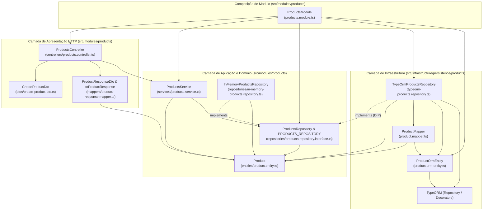

# ARTEFATO 12-02 — RECONSTRUÇÃO DA ARQUITETURA E MAPA DE DEPENDÊNCIAS

## 1. Distinção Fundamental: Fluxo de Execução vs. Dependências de Código

Na auditoria arquitetural do fluxo `UC12 — Cadastrar Produto`, é indispensável distinguir duas perspectivas que não possuem a mesma direção em todos os trechos:

- **Fluxo de execução (tempo de execução / *runtime*):** descreve a ordem cronológica em que as chamadas e os dados atravessam os objetos instanciados desde a chegada da requisição HTTP até o banco PostgreSQL e o retorno da resposta.
- **Dependências arquiteturais (tempo de compilação / código-fonte):** descrevem quais módulos, classes ou interfaces são importados (`import`) e conhecidos estaticamente por cada arquivo. Graças à **Inversão de Dependência (DIP)** na fronteira de persistência, o fluxo de execução desce de `ProductsService` para `TypeOrmProductsRepository`, mas a dependência de código aponta de `TypeOrmProductsRepository` para a abstração `ProductsRepository` definida no módulo de domínio/aplicação.

---

## 2. Mapa do Fluxo de Execução (Runtime)

### 2.1. Diagrama da Sequência Lógica de Cadastro (`POST /products`)

```text
Cliente HTTP
      |
      |  1. POST /products {"name": "Produto de exemplo"}
      v
ValidationPipe (global em main.ts)
      |
      |  2. Valida e transforma payload em CreateProductDto (whitelist: true)
      v
ProductsController.create(dto)
      |
      |  3. Chama createProduct(dto.name)
      v
ProductsService.createProduct(name)
      |
      |  4. Instancia new Product(randomUUID(), name)
      |  5. Invoca save(product) via referência injetada no token PRODUCTS_REPOSITORY
      v
ProductsRepository (contrato / interface em tempo de design)
      |
      |  6. Despacho polimórfico em runtime para o provider concreto registrado
      v
TypeOrmProductsRepository.save(product)
      |
      |  7. Converte Product -> ProductOrmEntity via ProductMapper.toPersistence(product)
      |  8. Chama this.ormRepository.save(entity)
      v
TypeORM (Repository<ProductOrmEntity>)
      |
      |  9. Executa INSERT / UPDATE parametrizado no schema "products"."products"
      v
PostgreSQL (celilac_db na porta 5432 ou celilac_test na porta 5435)
      |
      | 10. Retorna linha persistida -> ProductOrmEntity
      | 11. ProductMapper.toDomain(savedEntity) reconstrói Product
      | 12. Retorna Product ao ProductsService e deste ao ProductsController
      | 13. ProductsController aplica toProductResponse(product) -> ProductResponseDto
      | 14. Responde HTTP 201 Created {"productId": "...", "name": "..."}
```

> **Nota técnica:** Este diagrama representa a trajetória da chamada em tempo de execução. Ele **não** indica que `ProductsService` ou `ProductsRepository` dependam estaticamente de `TypeOrmProductsRepository`.

---

## 3. Mapa das Dependências Arquiteturais (Compilação)

### 3.1. Diagrama de Direção das Dependências de Código

```text
ProductsController
       |
       |  depende de (importa ProductsService, CreateProductDto,
       |              ProductResponseDto, toProductResponse)
       v
ProductsService
       |
       |  depende apenas de (importa Product, PRODUCTS_REPOSITORY,
       |                     type ProductsRepository)
       v
ProductsRepository (Interface + Token PRODUCTS_REPOSITORY)
       ^
       |  implementa (importa type ProductsRepository e Product)
       |  [INVERSÃO DE DEPENDÊNCIA — DIP]
TypeOrmProductsRepository
       |
       |  depende de (importa @InjectRepository, Repository<ProductOrmEntity>,
       |              ProductOrmEntity, ProductMapper)
       v
    TypeORM
```

### 3.2. Grafo Completo de Importações Estáticas Verificado nos Arquivos



---

## 4. Mapa dos Providers e Composição de Dependências (`ProductsModule`)

Como interfaces TypeScript (`ProductsRepository`) são removidas na transpilação para JavaScript, o fato de `TypeOrmProductsRepository` declarar `implements ProductsRepository` **não** permite, por si só, que o contêiner de Injeção de Dependências (DI) do NestJS resolva a dependência em tempo de execução.

A resolução ocorre porque `ProductsModule` (`src/modules/products/products.module.ts`) realiza explicitamente a amarração (*binding*) entre o token `PRODUCTS_REPOSITORY` e a classe concreta:

```typescript
@Module({
  imports: [TypeOrmModule.forFeature([ProductOrmEntity])],
  controllers: [ProductsController],
  providers: [
    ProductsService,
    {
      provide: PRODUCTS_REPOSITORY,
      useClass: TypeOrmProductsRepository,
    },
  ],
  exports: [ProductsService],
})
export class ProductsModule {}
```

### 4.1. Tabela de Resolução de Providers no Contêiner NestJS

| Consumidor | Ponto de Injeção | Token Solicitado | Provider Registrado em Produção (`ProductsModule`) | Provider Substituído em Testes |
| :--- | :--- | :--- | :--- | :--- |
| **NestJS Router** | `@Controller('products')` | `ProductsController` | `controllers: [ProductsController]` | Instanciado em `products.controller.spec.ts` e `products.integration.spec.ts` |
| **`ProductsController`** | `constructor(private readonly productsService: ProductsService)` | Classe `ProductsService` | `providers: [ProductsService]` | Mock `serviceMock` via `useValue` em `products.controller.spec.ts` |
| **`ProductsService`** | `@Inject(PRODUCTS_REPOSITORY) private readonly productsRepository: ProductsRepository` | Token string `'PRODUCTS_REPOSITORY'` | `{ provide: PRODUCTS_REPOSITORY, useClass: TypeOrmProductsRepository }` | Mock `productsRepositoryMock` (`products.service.spec.ts`) ou `InMemoryProductsRepository` via `.overrideProvider(PRODUCTS_REPOSITORY).useClass(...)` (`products.integration.spec.ts`) |
| **`TypeOrmProductsRepository`** | `@InjectRepository(ProductOrmEntity) private readonly ormRepository: Repository<ProductOrmEntity>` | Token gerado por `getRepositoryToken(ProductOrmEntity)` | Registrado por `TypeOrmModule.forFeature([ProductOrmEntity])` | Substituído por `.overrideProvider(getRepositoryToken(ProductOrmEntity)).useValue({})` em `products.integration.spec.ts`, ou injetado diretamente via `dataSource.getRepository(ProductOrmEntity)` em `typeorm-products.repository.postgres.spec.ts` |

---

## 5. Relação e Distinção entre os Dois Mappers

A arquitetura possui dois mappers com responsabilidades, direções e localizações estritamente separadas:

| Dimensão | Mapper HTTP (`toProductResponse`) | Mapper de Persistência (`ProductMapper`) |
| :--- | :--- | :--- |
| **Arquivo** | `src/modules/products/mappers/product-response.mapper.ts` | `src/infrastructure/persistence/products/product.mapper.ts` |
| **Camada** | Fronteira de Apresentação HTTP | Infraestrutura de Persistência |
| **Direção da Transformação** | Unidirecional: `Product → ProductResponseDto` | Bidirecional: `Product ↔ ProductOrmEntity` (`toPersistence` e `toDomain`) |
| **Quem Invoca** | `ProductsController.create()` | `TypeOrmProductsRepository.save()` |
| **Modelos Envolvidos** | `Product` (domínio) e `ProductResponseDto` (contrato público JSON) | `Product` (domínio) e `ProductOrmEntity` (esquema relacional TypeORM) |
| **Responsabilidade** | Garantir que a resposta HTTP contenha exclusivamente os campos públicos contratados (`productId`, `name`), filtrando propriedades internas | Adaptar a entidade de domínio para a estrutura exigida pelo ORM e reconstruir a entidade de domínio após a persistência |

---

## 6. Identificação Completa dos Arquivos e Justificativa das Relações

| Arquivo | Importações Estáticas Observadas | Justificativa Arquitetural da Relação |
| :--- | :--- | :--- |
| `src/modules/products/entities/product.entity.ts` | Nenhuma importação externa | O núcleo de domínio (`Product`) é 100% independente de frameworks, HTTP e banco de dados. |
| `src/modules/products/repositories/products.repository.interface.ts` | `Product` | Define a porta de saída (*outbound port*) da aplicação usando exclusivamente tipos do domínio. |
| `src/modules/products/services/products.service.ts` | `randomUUID` (`node:crypto`), `Inject`/`Injectable` (`@nestjs/common`), `Product`, `PRODUCTS_REPOSITORY`, `type ProductsRepository` | Orquestra o caso de uso dependendo apenas do domínio e da abstração de persistência, sem conhecer TypeORM ou HTTP. |
| `src/modules/products/dtos/create-product.dto.ts` | `IsNotEmpty`, `IsString` (`class-validator`) | Isola as regras de validação sintática do payload de entrada na borda HTTP. |
| `src/modules/products/mappers/product-response.mapper.ts` | `Product` | Traduz a entidade de domínio para o DTO de resposta pública sem acoplar o domínio à serialização HTTP. |
| `src/modules/products/controllers/products.controller.ts` | `Body`/`Controller`/`Post` (`@nestjs/common`), `CreateProductDto`, `ProductResponseDto`/`toProductResponse`, `ProductsService` | Coordena a fronteira HTTP: recebe o DTO validado, aciona o caso de uso no Service e devolve o DTO público via mapper HTTP. |
| `src/infrastructure/persistence/products/product.orm-entity.ts` | `Column`, `Entity`, `PrimaryColumn` (`typeorm`) | Isola o mapeamento objeto-relacional (`products.products`) na camada de infraestrutura. |
| `src/infrastructure/persistence/products/product.mapper.ts` | `Product`, `ProductOrmEntity` | Impede que `ProductOrmEntity` vaze para o Service ou que `Product` receba decoradores do TypeORM. |
| `src/infrastructure/persistence/products/typeorm-products.repository.ts` | `Injectable`, `InjectRepository`, `Repository`, `Product`, `type ProductsRepository`, `ProductMapper`, `ProductOrmEntity` | Implementa o adaptador concreto de persistência (*outbound adapter*), invertendo a dependência em relação a `ProductsRepository`. |
| `src/modules/products/repositories/in-memory-products.repository.ts` | `Injectable`, `Product`, `ProductsRepository` | Fornece implementação substituta leve (*fake/in-memory*) do contrato `ProductsRepository` para testes de integração rápidos do módulo. |
| `src/modules/products/products.module.ts` | `Module`, `TypeOrmModule`, `ProductOrmEntity`, `TypeOrmProductsRepository`, `ProductsController`, `PRODUCTS_REPOSITORY`, `ProductsService` | Ponto focal de configuração (*Composition Root* do módulo): único local do módulo que conhece simultaneamente as abstrações e os adaptadores concretos para conectá-los no contêiner de DI. |
